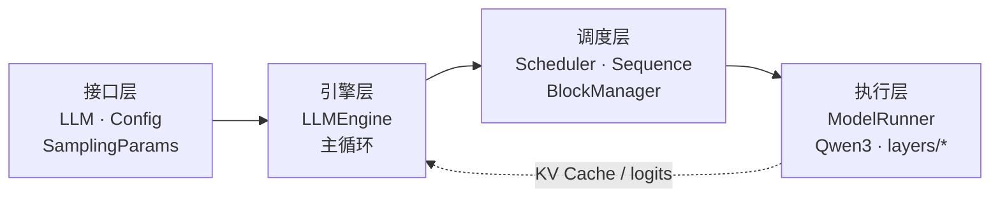
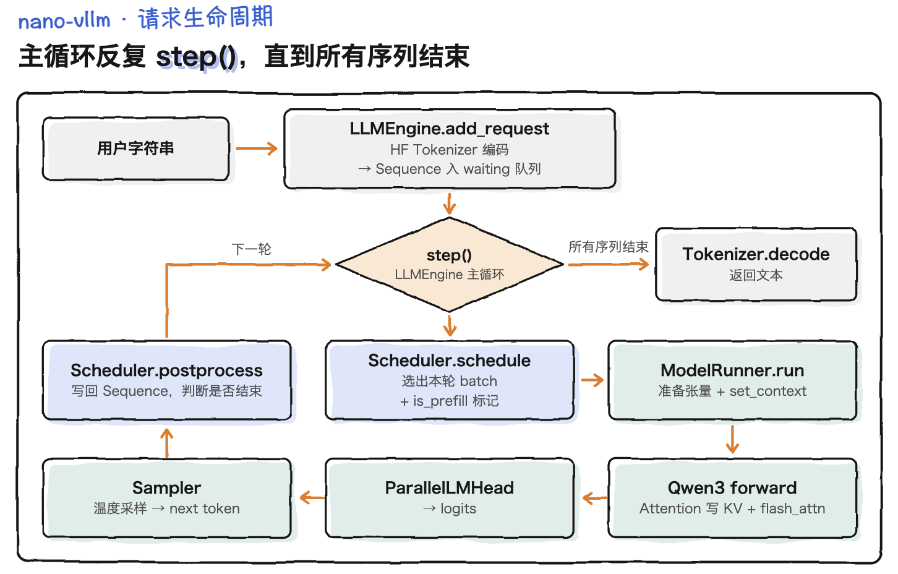

# LLM 推理笔记：从 KV Cache 到推理引擎

这份笔记按「基础指标 → vLLM 使用 → 显存管理 → 调度 → 前缀复用 → 图优化 → nano-vllm 实现 → 投机解码」的顺序展开。文中涉及的默认值和内部实现会随版本变化，具体部署以所用版本的文档和源码为准。

## 1. 推理基础与性能指标

### Prefill、Decode 与 KV Cache

Prefill 并行处理输入 Prompt，是 TTFT（Time to First Token，首 Token 延迟）的主要组成部分；Decode 逐 Token 生成输出，通常用 TPOT（Time per Output Token，平均每个后续输出 Token 的耗时）衡量。

KV Cache 的生命周期：

- **分配**：请求进入后，引擎按需为 KV Cache 分配显存；具体粒度取决于缓存管理方式。
- **填充**：Prefill 阶段一次性把整段 Prompt 的 K、V 算出来写进缓存；Decode 每步再追加 1 个 Token 的 K、V
- **使用**：每一步 Decode 都要读取全部历史 KV 来算 Attention
- **释放**：请求生成结束（EOS 或达到长度上限），显存归还

如果不保存 KV，每生成一个 Token，都要重新计算已有上下文的 K、V；KV Cache 用显存换掉了这部分重复计算。

在标准全注意力、各层 KV 形状相同且不计块元数据等开销时，缓存容量约为：

$$
\boxed{ M_{\text{KV}}=2\times B\times L\times S\times H_{kv}\times D\times P }
$$

其中：

| 参数       | 含义                             | 示例           |
| ---------- | -------------------------------- | -------------- |
| \(2\)      | K 和 V 两份缓存                  | 2              |
| \(B\)      | Batch Size（同时缓存的序列数）   | 1              |
| \(L\)      | Transformer 层数                 | 32             |
| \(S\)      | Sequence Length（缓存 Token 数） | 4096           |
| \(H_{kv}\) | KV Heads 数量                    | 8              |
| \(D\)      | Head Dimension                   | 128            |
| \(P\)      | 每个元素的字节数                 | BF16 = 2 Bytes |

注意：这里使用的是 KV Heads，而不是 Query Heads。

### GQA 与 KV 头数

若分组大小 `G = 4`，每 4 个 Query 头共享一组 K/V 头。MHA 中 `H_q = H_kv`；GQA 中 `H_q = G × H_kv`；MQA 则只有一个 KV 头。

**关键点**：KV Cache 大小与 KV 头数成正比。若 Query 头数为 32、KV 头数为 8，其他条件不变时，相比 32 个 KV 头的 MHA，缓存约降至 **1/4**。GQA/MQA 减少显存占用，但效果和性能仍需按模型评估。

### KV Cache 的碎片化

请求实际只生成了 100 个 Token，却按 2048 预留，剩下的座位全部空占——这叫**内部碎片**；

不同请求预留块之间的空隙又凑不成一整块可用空间——这叫**外部碎片**。

碎片化会让 KV Cache 的实际显存利用率大打折扣，大量显存被无效预留白白浪费。这正是 vLLM 的 PagedAttention 要解决的核心问题——它把连续大块换成了操作系统式的分页管理

### 性能指标

#### 延迟

| 指标 | 含义 |
| --- | --- |
| TTFT | 从提交请求到收到首个输出 Token 的时间，包含排队、预处理与 Prefill 等开销。 |
| TPOT | 首 Token 之后，平均每个输出 Token 的耗时。 |
| E2E latency | 从提交请求到收到完整响应的时间。 |

输出长度为 `N ≥ 1` 时，若 TPOT 取后续 Token 间隔的平均值，则 `E2E latency = TTFT + (N - 1) × TPOT`。短输出通常更受 TTFT 影响，长输出则更受 TPOT 影响。

先测清楚自己的输入输出长度分布，再谈优化

#### 吞吐

| 指标              | 含义                        | 适用视角               |
| :---------------- | :-------------------------- | :--------------------- |
| Token/s（系统）   | 全系统每秒生成的总 Token 数 | 衡量集群整体产能与成本 |
| Token/s（单用户） | 单个用户感受到的出字速度    | 约等于 1/TPOT          |
| RPS（Requests/s） | 每秒成功完成的请求数        | 衡量并发承载能力       |

系统吞吐会随并发上升而增长，直到 GPU 资源饱和后趋于平稳甚至回落。

**吞吐和延迟通常是一对矛盾**：把更多请求塞进一个 Batch 能提高系统吞吐，但每个请求的排队和计算时间变长，单用户延迟变差。

#### 尾延迟与 Goodput

平均延迟是最容易骗人的指标。真实流量下，少数请求可能慢得离谱，而平均值把它们藏了起来。所以生产环境更看**尾延迟**

- **P95 / P99**：95% / 99% 的请求比它快——这才是用户投诉的来源

**Goodput（有效吞吐）**是比 Raw QPS 更贴近真实价值的指标。它只统计**满足 SLO（比如 TTFT < 1s 且 TPOT < 50ms）的那部分请求的吞吐**。一个系统 QPS 很高但大部分请求都超时，Goodput 就很低——用户根本用不爽

### Decode 的性能瓶颈

小 Batch 的 Decode 往往受显存带宽限制：以 FP16/BF16 线性层为例，单 Token 对每个权重约做一次乘加（约 2 FLOPs），读取一个 2 字节权重，忽略激活和缓存流量时，权重相关算术强度约为 **1 FLOP/Byte**。这只是简化估算，不能据此直接推断整卡利用率。

将多个请求组成 Batch 后，线性层计算可看作 `[B, D] × [D, D]`；多个 Token 复用同一批权重，通常能提高吞吐。收益会受 KV 读取、Batch 大小、Kernel 和硬件限制。

1. **Batching**：同一次前向让多个 Decode Token 分摊权重读取，通常提高系统吞吐；Batch 过大也会拉长单步耗时及排队时间。
2. **Weight-only 量化**：仅比较原始权重，INT4 的位宽是 FP16 的 **1/4**。实际节省和加速还受量化元数据、反量化、KV 访问与 Kernel 实现影响。

| 环节        | 做什么                                                  | 计算特性           | 潜在瓶颈                    |
| :---------- | :------------------------------------------------------ | :----------------- | :-------------------------- |
| Tokenize    | 把输入文本切成 Token ID 序列                            | CPU 任务           | 长文本或高并发时 CPU 成瓶颈 |
| Prefill     | 并行处理全部 Prompt Token，产出首 Token 与初始 KV Cache | GPU，Compute Bound | Prompt 很长时拉高 TTFT      |
| Decode Loop | 逐 Token 生成，每步读全量 KV、追加新 KV                 | GPU，Memory Bound  | 显存带宽，决定 TPOT         |
| Sampling    | 从输出分布按 Temperature/Top-p 等采样下一个 Token       | GPU，轻量          | 复杂采样或约束解码略增开销  |
| Detokenize  | 把 Token ID 拼回可读文本，流式返回                      | CPU 任务           | 与主循环争抢 CPU            |

Tokenize / Detokenize 是 **CPU 任务**，却容易被忽视。当 GPU 优化到位后，CPU 上的这些环节反而可能成为新瓶颈——这正是 vLLM V1 引擎用多进程把它们和 GPU 核心循环重叠起来的原因

## 2. vLLM：使用与核心能力

| 特性                    | 说明                                                         |
| :---------------------- | :----------------------------------------------------------- |
| **PagedAttention**      | 借鉴分页思想按块管理 KV Cache，减少预留浪费 |
| **Continuous Batching** | 动态地将新请求插入正在处理的批次，而非等一批全部完成再开始下一批 |
| **OpenAI 兼容 API**     | 提供兼容的服务端接口；客户端仍需确认模型名及参数。 |
| **模型与硬件支持**      | 支持多种模型架构和硬件，具体组合取决于版本与后端。 |
| **量化支持**            | 支持多种量化格式，实际可用性需按模型与硬件核对。 |

核心关系：PagedAttention 提高 KV Cache 利用率；Continuous Batching 提高请求调度效率；高效 Kernel 与图优化降低单步执行开销。

LLM 在 Decode 阶段需要读取历史 Token 的 K、V。早期连续分配方案可能按预期最大长度预留较大空间，造成浪费；PagedAttention 让逻辑连续的缓存映射到可分散的物理块。

这就带来了三个问题：

- **内部碎片**：大多数请求用不到最大长度，预留空间大量浪费
- **外部碎片**：请求结束后释放的空间大小不一，难以被新请求复用
- **共享不灵活**：多个请求的相同前缀难以在连续布局中高效复用；并非完全无法实现共享。

KV Cache 占用取决于层数、上下文长度、KV 头数和精度，应使用上一节的公式估算，而非仅凭模型参数量判断。

1. **分块存储**：KV Cache 不再要求连续内存，而是被切分成固定大小的 Block（如 16 个 token 为一个 Block）
2. **按需分配**：每生成一个 token，只在当前 Block 未满时追加，填满后才分配新的 Block
3. **映射表管理**：每个请求维护一个 Block Table，记录自己的逻辑 Block 到物理 Block 的映射关系
4. **内存共享**：多个请求如果有相同的前缀（如 System Prompt），可以共享同一组物理 Block，大幅节省显存

**注意**：PagedAttention 的分块存储意味着 KV Cache 在物理上是不连续的，vLLM 需要专门的 CUDA Kernel 来高效地从分散的 Block 中读取数据进行 Attention 计算。

### 离线推理

离线推理适合**不需要实时响应**的场景，如批量文本生成、数据标注、评测跑分等。vLLM 提供 `LLM`类作为离线推理的主入口
```
llm.generate()
```

### Chat Template

```python
llm.chat(messages_list, sampling_params)

# 手动应用 chat template
texts = tokenizer.apply_chat_template(
    messages_list,
    tokenize=False,
    add_generation_prompt=True,
)

outputs = llm.generate(texts, SamplingParams(temperature=0.7))
```

会构造这种role，模型在 SFT（Supervised Fine-Tuning）阶段接触了大量按照 Chat Template 构造的训练数据
```
<|im_start|>user
1 + 1 = ?<|im_end|>
<|im_start|>assistant
2<|im_end|>
```

### 在线服务
```
vllm serve Qwen/Qwen2.5-7B-Instruct \
    --host 0.0.0.0 \
    --port 8080 \
    --tensor-parallel-size 2
```
```
v1/chat/completions
```

| 接口 | 用途 |
| --- | --- |
| `POST /v1/completions`      | 文本补全 |
| `POST /v1/chat/completions` | 对话补全 |

采样参数（SamplingParams）

| 参数                 | 说明                                     | 默认值       |
| :------------------- | :--------------------------------------- | :----------- |
| `temperature`        | 控制随机性，越高越随机                   | 1.0          |
| `top_p`              | 核采样，只从累计概率前 p 的 token 中采样 | 1.0          |
| `top_k`              | 只从概率最高的 k 个 token 中采样         | 随版本而定；0 或 -1 常表示不限制 |
| `max_tokens`         | 最大生成 token 数                        | 随版本及调用方式而定 |
| `repetition_penalty` | 重复惩罚系数，>1 减少重复                | 1.0          |
| `stop`               | 遇到指定字符串时停止生成                 | None         |
| `n`                  | 为每个 prompt 生成的序列数               | 1            |
| `seed`               | 随机种子，设置后可复现结果               | None         |

采样参数应按任务评估。需要更稳定输出时可从 `temperature=0` 开始，并显式设置 `max_tokens`；模型的 `generation_config.json` 也可能影响默认采样值。

| 参数                         | 说明                 | 设置建议           |
| :--------------------------- | :------------------- | :--------------- |
| `--model`                    | HuggingFace 模型标识 | -                |
| **`--tensor-parallel-size`** | 张量并行 GPU 数      | 根据模型大小决定 |
| `--gpu-memory-utilization`   | GPU 显存使用比例     | 按显存余量和 KV 需求调整 |
| `--max-model-len`            | 模型最大序列长度     | 按需设置         |
| `--dtype`                    | 模型权重精度         | auto             |
| `--quantization`             | 量化方式             | None             |
| `--max-num-seqs`             | 单步最大并发序列数   | 按目标负载压测 |
| **`--enforce-eager`**        | 禁用 CUDA Graph      | 调试时使用       |

### 张量并行

模型单卡放不下，或单卡性能无法满足目标时，可考虑张量并行。它增加跨卡通信，实际收益需结合互联带宽与负载测试。

## 3. PagedAttention：块管理与抢占

Attention 计算时，CUDA Kernel 通过 Block Table 拿到每个逻辑位置对应的 `physical_block_number`（物理块号）和 `physical_block_offset`（块内偏移），就能从分散的物理块里正确读到所有历史 KV。

传统 Attention 假设一个序列的 K、V 在显存里是**连续排列**的，Kernel 直接用一个基地址加偏移就能顺序扫过去。PagedAttention 打破了连续性，于是 Kernel 必须先查块表，把"逻辑位置"翻译成"物理地址"。核心是两个量：

- **`physical_block_number`（物理块号）**：决定去哪一个物理块里取数，乘以块的跨度（block stride）得到块的基址。
- **`physical_block_offset`（块内偏移）**：定位这个 Token 在块内的第几格。

vLLM 官方 Kernel 文档里，Key 指针的地址计算大致是这样一个形式（简化示意，非逐字照搬）：
```
// 根据物理块号 + 头偏移 + 块内偏移，算出这个 token 的 Key 起始地址
const scalar_t* k_ptr = k_cache
                      + physical_block_number * kv_block_stride   // 定位到物理块
                      + kv_head_idx           * kv_head_stride    // 定位到对应 KV 头
                      + physical_block_offset * x;                // 定位块内 token
```

间址查表的代价，就藏在这每次迭代的地址重算里——这也是下文"代价与权衡"要讨论的开销来源。

vLLM 官方这篇 Kernel 走读文档明确标注为"基于原始论文的历史文档，不再反映 vLLM 当前代码"。所以上面的指针公式请当作**理解原理的示意**，而非当前源码。真正想读实现，要去看 V1 引擎的 Attention 后端

### 内存共享与 Copy-on-Write

**跨请求共享前缀**：一批请求用了相同的 System Prompt，它们的前缀 KV 完全相同，就没必要各存一份——让它们的块表都指向同一批物理块即可。这种共享是**只读**的

**同一请求内的分叉**：从同一个 Prompt 并行采样多个回答（`n > 1`）或做 Beam Search 时，多个候选序列共享 Prompt 的 KV，但会在某个块**内部**开始分叉——这才是需要下面 CoW 的场景

**那如果共享同一个块的两个序列，后来生成的内容分叉了怎么办？**

* 只读共享时，大家指向同一块，靠**引用计数（ref_cnt）**记录有几个请求在用

- 当某个请求要往一个被共享的块里写新内容时，先把这个块复制一份成为它的私有块，在副本上写，再更新自己的块表指向副本。其他请求不受影响。

一般来说 COW 通常不是因为要修改已经生成的历史 Token 的 KV，而是因为要向尚未填满的共享 Block 中追加新 Token 的 KV

### 显存不足时的抢占

某一步 Decode 需要为若干请求追加新块，但空闲物理块不够。调度器会挑选部分请求"踢出"，释放它们占用的物理块。被踢出的请求，其已经算好的 KV Cache 有两种处理方式

| 恢复方式                    | 做法                                                         | 优点                    | 代价                                    |
| :-------------------------- | :----------------------------------------------------------- | :---------------------- | :-------------------------------------- |
| **换出（Swapping）**        | 把 KV Cache 从 GPU 显存拷贝到 CPU 内存暂存，恢复时再拷回来   | 不用重算，省算力        | 占用 CPU 内存，来回拷贝有 PCIe 传输开销 |
| **重计算（Recomputation）** | 直接丢弃 KV，恢复时把该请求已生成的 Token 当成新 Prompt 重新 Prefill 一遍 | 不占 CPU 内存，实现简单 | 要重跑一次 Prefill，浪费算力            |

上表是 PagedAttention 论文和早期实现讨论的两种恢复思路。vLLM V1 的常规抢占路径采用重计算：释放块并重置已计算 Token 数，恢复时重新推进 Prefill。若前缀缓存中的满块仍可复用，实际重算量会减少。

抢占可以缓解 KV Cache 显存不足，但会增加重计算和延迟，不能保证所有情况下都不发生 OOM 或请求失败。若抢占频繁，应结合并发、KV Cache 空间和显存余量调参。

通常先观察 `gpu_memory_utilization`、并发和前缀缓存命中率，再考虑块大小等底层参数；默认值随版本和硬件而变。

### KVCacheManager vs BlockPool

Scheduler -> KVCacheManager -> BlockPool

- **`KVCacheManager`**（`kv_cache_manager.py`）：**请求视角**的管理者。调度器每一步都通过它给请求申请、释放块。核心方法和前面讲的概念一一对应：
  - `get_computed_blocks`：前缀缓存查询，返回该请求能命中的、已经算好的块，以及命中了多少 Token。这是第 5 节前缀复用的入口。
  - `allocate_slots`：为请求新增的 Token 申请槽位/块，顺带释放不再需要的块，并检查空闲块是否够用；不够就返回 `None`（交给调度器触发抢占）。它对应本节的按需分块。
  - `free`：请求结束时**逆序**释放它的块——让尾部的块先被回收，因为头部的块更可能被前缀缓存复用，留得越久越好。
- **`BlockPool`**（`block_pool.py`）：**全局视角**的物理块仓库，不关心哪个请求，只管”哪些块空着、哪些块被缓存着”。

`BlockPool` 里所有块存在一个普通列表 `self.blocks: list[KVCacheBlock]`（按 block id 索引），但**空闲块**单独用一个 `FreeKVCacheBlockQueue` 管理——它内部是一条**双向链表**，而不是简单的栈或 `deque`

原因是空闲块要同时支持两种操作：

- **分配时**从头部快速取走 N 个（`popleft_n`）；
- **前缀缓存命中时**，一个原本”空闲但仍缓存着有效内容”的块要被重新激活——需要从链表**中间任意位置**把它摘出来（`remove`）

若已持有节点引用，双向链表能在 O(1) 时间从中间摘除节点。前缀缓存允许空闲块保留可复用内容，因此需要这种操作。

这里free block只代表没有running request在用它

因此，一个 Block 可以同时满足：

- `ref_cnt = 0`：没有活跃请求引用它，可以被重新分配。
- `block_hash != None`：它仍然记录着之前计算过的 KV Cache 内容，可以被其他请求复用。

所以 **空闲块也可能是一个有效的缓存块**。
```
class KVCacheBlock:
    def __init__(self, block_id):
        self.block_id = block_id
        self.ref_cnt = 0
        self.block_hash = None

        # 双向链表指针
        self.prev_free_block = None
        self.next_free_block = None
```

这里一个block对象，之前prev和next，就可以直接O(1)删除了

1. **释放不等于清空**：`ref_cnt` 归零的块只是回到空闲链表，**内容还在**。如果后续请求的前缀哈希命中它，`touch()` 直接把它复活复用，这就是 Automatic Prefix Caching 省掉重复 Prefill 的底层机制。
2. **带哈希的块留得更久**：释放时，vLLM 把”没缓存价值的块”放链表头（优先被再分配覆盖，源码注释说这样还能让刚释放的块被立即复用，GPU 局部性更好），“带哈希、有复用潜力的块”放链表尾（晚点才被淘汰）。分配总从链表头取，于是带哈希的块按释放先后被淘汰，效果就是 LRU。

**V1 的 BlockPool 里没有 CoW。** 上面三个函数只做 `ref_cnt` 的增减和空闲链表的摘挂，没有任何”复制块”的逻辑。V1 能绕开 CoW，靠的是两点设计：

- **只共享写满的块**：前缀缓存只对已写满的块计算哈希并共享，未写满的尾块不参与共享；新生成的 Token 一律追加到请求自己的新块里。因此跨请求的前缀共享始终是只读的，没有”往共享块里写”的时刻。
- **`n > 1` 拆成独立子请求**：V1 把并行采样拆成 `n` 个 `n = 1` 的子请求（见 `vllm/v1/engine/parallel_sampling.py` 中的 `ParentRequest`），子请求之间通过前缀缓存共享 Prompt 的满块，不再需要块内分叉。

```python
# 伪代码：还原 BlockPool 的关键逻辑（非逐字源码）
def get_new_blocks(self, num_blocks):
    if num_blocks > self.get_num_free_blocks():
        raise ValueError("空闲块不足")          # 触发上层抢占
    blocks = self.free_block_queue.popleft_n(num_blocks)
    for blk in blocks:
        assert blk.ref_cnt == 0                 # 新分配的块必须无人引用
        blk.ref_cnt += 1
    return blocks

def free_blocks(self, ordered_blocks):
    for blk in ordered_blocks:
        blk.ref_cnt -= 1
    to_free = [b for b in ordered_blocks if b.ref_cnt == 0]   # 没人用了才真正回收
    no_hash = [b for b in to_free if b.block_hash is None]
    has_hash = [b for b in to_free if b.block_hash is not None]
    self.free_block_queue.prepend_n(no_hash)    # 没有缓存价值：放链表头，最先被复用
    self.free_block_queue.append_n(has_hash)    # 带哈希：放链表尾，最晚被淘汰

def touch(self, blocks):                        # 前缀缓存命中时调用
    for blk in blocks:
        if blk.ref_cnt == 0:                    # 从空闲链表里"抢救"回来
            self.free_block_queue.remove(blk)
        blk.ref_cnt += 1
```

## 4. Continuous Batching：迭代级调度

将多个请求放进同一步执行，通常能提高吞吐；单请求延迟是否增加，取决于 Batch 大小、排队、KV 读取和硬件瓶颈。

1. **收新请求**：把新到达的请求放进 Waiting（等待）队列。
2. **调度决策**：调度器决定这一步谁上车。它要同时兼顾两拨请求——正在生成的 Running 队列请求（做 Decode），和等待队列里能塞进来的新请求（做 Prefill）。是否有空间，取决于显存里还有多少空闲 KV Block（这正是 PagedAttention 提供的信息）。
3. **前向计算一步**：对选中的这批请求跑一次模型前向，每个 Decode 请求产出 1 个新 Token，Prefill 请求产出首 Token。
4. **处理产出**：把新 Token 追加到各请求的 KV Cache；检查哪些请求触发了 EOS 或长度上限，将其标记完成、**释放其占用的 KV Block** 归还给空闲池。
5. **循环**：回到第 1 步。

**提示**：当显存不够、Running 队列里请求太多时，调度器还会做**抢占（Preemption）**：暂停部分请求、释放它们的 KV Block，腾出显存保证其他请求推进。vLLM V1 被抢占的请求一律丢弃 KV、恢复时重算，第 3 节有对应说明。

| 技术                | 解决的问题         | 提供的能力                   |
| :------------------ | :----------------- | :--------------------------- |
| PagedAttention      | 显存碎片、利用率低 | 细粒度、可即时回收的显存分配 |
| Continuous Batching | GPU 空转、排队延迟 | 迭代级调度、动态批次构成     |

**PagedAttention 管”显存怎么放”，Continuous Batching 管”请求怎么调度”，二者相乘才有 vLLM 的高吞吐**

V1 相比 V0 最大的设计变化是——**调度器眼里不再有”Prefill 阶段”和”Decode 阶段”之分**。源码注释里明确写了 “no ‘decoding phase’ nor ‘prefill phase’“：每个请求只是不停地把 `num_computed_tokens`（已计算 Token 数）推向 `num_tokens_with_spec`（含投机 Token 的总目标数）。这种统一视角，正是 2.4 节 Chunked Prefill 能把 Prefill 和 Decode 混在一步里跑的前提。

### Scheduler 的两条队列
```
                Scheduler.schedule()
                       |
          +------------+------------+
          |                         |
       RUNNING                    WAITING
          |                         |
     分配计算资源               尝试加入 Batch
          |                         |
     KV 不足 → Preempt       资源足够 → RUNNING
          |                         |
          +------→ WAITING          |
                                    |
                          参与 Prefill / Decode
```

- **`self.running`**：一个列表，装当前正在计算的请求。
- **`self.waiting`**：一个**优先级队列**，装排队等待的请求。调度策略有两种——`FCFS`（先来先服务）和 `PRIORITY`（按优先级）。v0.32.0 里还有几个辅助队列：`kv_holding_waiting`、`deferred_waiting`，以及每步临时使用的 `step_skipped_waiting` 等，用来暂存本步因依赖未就绪（如异步 KV 传输尚未完成）而不能调度的请求。读主干逻辑时可以先忽略它们。

”调度 → 前向 → 处理产出”循环：

- **`schedule()`**：一步调度的核心。它给一个 **token 预算（`token_budget`）**，先遍历 `running` 队列给正在生成的请求分配 Token 和 KV 块，预算还有富余、且没发生抢占时，再从 `waiting` 队列拉新请求进来。最后打包成 `SchedulerOutput` 交给模型执行。
- **`update_from_output()`**：拿到模型这一步的输出后，把采样出的 Token 追加回各请求、检查停止条件（EOS/长度上限）、释放已完成请求的资源，并组装成返回给客户端的结果。

```python
# 伪代码：还原 V1 Scheduler.schedule() 的主干逻辑（非逐字源码）
def schedule(self):
    token_budget = self.max_num_batched_tokens
    scheduled = []
    preempted = []

    # 第一优先级：喂饱正在运行的请求（Decode 为主）
    req_index = 0
    while req_index < len(self.running) and token_budget > 0:
        req = self.running[req_index]
        num_new = compute_new_tokens(req, token_budget)   # 受预算/max_model_len 限制
        while True:                                       # 申请不到就抢占，再重试
            blocks = self.kv_cache_manager.allocate_slots(req, num_new)
            if blocks is not None:
                break
            victim = self.running.pop()                   # FCFS 踢最后一个（最晚加入的）
            self._preempt_request(victim)                 # 释放块，打回 waiting 队头
            preempted.append(victim)
            if victim is req:                             # 踢到自己，本请求这步不跑了
                break
        if blocks is None:
            break
        scheduled.append(req)
        token_budget -= num_new
        req_index += 1

    # 第二优先级：预算有富余且本步没发生抢占，才拉新请求做 Prefill
    if not preempted and token_budget > 0:
        while self.waiting and token_budget > 0:
            req = self.waiting.pop_front()
            if not self._can_admit(req):                  # 检查 running 上限/LoRA 等

              break
            self.running.append(req)
            scheduled.append(req)

    return SchedulerOutput(scheduled)
```

1. **在途请求优先于新请求**：先保证已经在跑的请求继续推进，剩余预算才用于接纳新请求。这避免了”新请求不断插队、老请求迟迟跑不完”的饥饿。
2. **抢占发生在显存耗尽时**：当 `allocate_slots` 返回 `None`（申请不到 KV 块），调度器就挑一个”受害者”抢占，释放它的块后**重试分配**，直到成功或者**踢到当前请求自己**为止。FCFS 策略下踢掉 `running` 里的最后一个（最晚加入的），PRIORITY 策略下踢 `(priority, arrival_time)` 最大的那个，即优先级最低、同优先级里来得最晚的请求。

被抢占的请求在 `_preempt_request()` 里经历一套清理：释放它的 KV 块和编码器缓存 → 状态置为 `PREEMPTED` → **`num_computed_tokens` 归零** → 重新塞回 `waiting` 队列的**队头**，等有资源了优先恢复。

**关键点**：注意 `num_computed_tokens` 归零这一步——它意味着 V1 的抢占恢复策略是**重计算（Recompute）**：被抢占的请求下次调度时，从头把 Prompt 和已生成的 Token 重新 Prefill 一遍，而不是从 CPU 换回 KV（与第 3 节的两种恢复方式呼应）。官方调优文档说明 V1 默认用重计算而非换出，因为在 V1 架构下重计算开销更低；开着 Prefix Cache 时，被释放的满块若还没被淘汰，恢复时可以直接命中。

**提示**：读调度器源码时抓住这条主线——**`waiting`/`running` 两队列 + `token_budget` 预算 + `allocate_slots` 返回值驱动抢占**。前文的调度循环，落到代码就是这三者的相互作用。更深入的调度细节（Chunked Prefill 如何切分）见第 6 节；第 8 节会用 nano-vllm 的精简 Scheduler 再走一遍同样的流程。

Continuous Batching 虽好，但调度器面对的是一组相互冲突的目标，工程上要清楚这些权衡：

- **吞吐 vs 延迟**：一步里塞进的请求越多，系统吞吐越高，但每步的前向计算耗时也越长，单请求的 TPOT 会略微变差。批次大小需要在两者间取平衡。
- **Prefill vs Decode 的争抢**：新请求的 Prefill 是 Compute Bound 的重活，如果某一步塞进一个超长 Prompt 的 Prefill，会明显拖慢同批 Decode 请求的出字速度（TPOT 抖动）。这个问题正是下一节 **Chunked Prefill** 要解决的——把长 Prefill 切块，避免它一次性霸占整个 step。
- **公平性 vs 效率**：先来的请求是否优先？长请求会不会被短请求反复插队饿死？调度策略需要在整体效率和请求间公平之间做取舍。

**注意**：Continuous Batching 让延迟指标变得**对负载敏感**。低负载时批次小、延迟低；高负载时批次变大、排队变长，P95/P99 尾延迟会明显上升。做容量规划时，一定要在**目标并发下**压测延迟，而不是看空载数据。

### 两种调度器的直观对比

**`running` 与 `waiting`**

Waiting 是queue， running是list，然后waiting queue左老右新，append右边，peek左边，popleft 左边，preempt的req appendleft

running抢占pop尾部，加入也是append 尾部

running 没有用链表来做到 O(1) 删除，因为调度时要按下标遍历，抢占时还要从尾部 pop。n 本来就很小，用 list 写起来简单，缓存局部性也好

这里nano-vllm 和 vllm v1里

prefill 影响首字延迟，decode 影响出字间隔。

#### nano-vllm：一步处理一种阶段

每一步都要做选择：这一步给新请求做 prefill，还是给老请求做 decode？

若始终优先 Decode，`running` 中有请求时新请求就难以进入，TTFT 可能很长，Batch 也会逐渐变小。

这个简化实现通常先处理新请求的 Prefill，再让它加入 `running` 一起 Decode；代价是已有请求的出字可能短暂停顿。这是该实现的调度取舍。

#### vLLM V1：Prefill 与 Decode 可以混排

既然一步里两种都能放，问题就变成了：token 预算有限时，先满足谁？

decode 很便宜：每条序列只要 1 个 token。running 里有 50 条序列，也只用掉 50 个预算。prefill 很贵：一个 prompt 可能就要几千个 token。

所以 v1 先把 running 里每条序列的 1 个 token 扣掉，保证老请求每步都能出一个字；剩下的大部分预算再给新请求做 prefill，放不下就分块。

结果是两边都照顾到了：老请求每步都前进，新请求也在同一步里开始 prefill。这里"先 decode"的意思不是让新请求等着，而是先扣掉decode的部分预算

## 5. Prefix Cache 与 RadixAttention

前缀能复用的前提，是显存管理支持”多个请求指向同一份 KV”

- KV Cache 以**固定大小的块**存储，请求通过块表间接引用物理块。
- 只要两个请求的某些前缀块内容相同，就让它们的块表**指向同一个物理块**，配合**引用计数**记录有几个请求在用。
- 新生成的内容写在各请求自己的新块里，共享块只读。vLLM V1 只共享已写满的块，因此跨请求复用不会出现”往共享块里写”的情况，也就不需要 Copy-on-Write。

所以 Prefix Cache 本质上是**把”共享前缀块”这件事从’同时并存的请求之间’扩展到’先后到达的请求之间’**：前一个请求算完的前缀块，先不急着扔，留在缓存里；后来的请求如果前缀匹配，直接复用这些块，跳过对应的 Prefill 计算。

**核心概念**：**Prefix Cache = 跨请求、跨时间地复用前缀 KV 块。** PagedAttention 的块共享是空间维度（并存请求共享），Prefix Cache 把它延伸到时间维度（先后请求复用）。

### vLLM 的自动前缀缓存

vLLM 的方案叫 **Automatic Prefix Caching（APC，自动前缀缓存）**。“Automatic”是它的一大亮点——**你不需要手动声明哪段是共享前缀，引擎自动检测并复用**。它靠的是对 KV 块做哈希。
```
block_hash=Hash(parent_hash, block_tokens, extra)
```

- extra（如 LoRA ID、多模态输入的哈希、cache salt 等）

把”父块哈希”纳入计算是精髓所在：它保证了**只有从序列开头到当前块的整条前缀都完全一致，哈希才会相同**。这样就精确刻画了”前缀相同”这件事

vLLM 自 v0.11 起默认使用 `sha256` 作为哈希算法，也可通过 `--prefix-caching-hash-algo` 切换为 `sha256_cbor`（跨语言可复现）、`xxhash`、`xxhash_cbor` 等。非加密算法（如 xxhash）更快，但碰撞风险略高。

新请求进来时，vLLM 逐块计算前缀哈希，拿去缓存表（hash → block ID 的映射）里查：

- **命中**：对应的物理块还在缓存里，直接把请求的块表指向它、增加引用计数，**跳过这部分 Prefill**。
- **未命中**：正常 Prefill 计算，算完后把新块的哈希登记进缓存，供后续请求复用。

**关键点**：命中前缀缓存能**直接砍掉那部分 Prefill 的计算**，最直接的收益是**大幅降低 TTFT**（首 Token 更快出来），同时省下的算力还能服务更多请求。共享前缀越长、命中率越高，收益越大。

#### V1 的低开销设计

vLLM V1 重写了前缀缓存管理：预建块元数据，并在块对象中嵌入双向链表指针，减少运行时分配和队列操作的开销。前缀缓存是否默认开启仍以具体版本和模型配置为准。

**为什么 V0 的 Prefix Caching 开销比较大**

如果未来没有任何 Request 复用这些 KV Cache，那么这些 Hash 计算、元数据维护和缓存管理就是额外开销。

而 vLLM 的 Scheduler 运行在 CPU 上，对于高吞吐、短 Request 场景，这些 Python 操作可能成为瓶颈

**V1：把所有 KVCacheBlock 元数据提前创建好**

首先需要区分：

- **GPU KV Cache 内存**：真正存储 Key、Value Tensor。
- **CPU KVCacheBlock 对象**：存储 Block ID、Hash、Ref Count 和链表指针等元数据。

V1 初始化时就建立固定数量的 `KVCacheBlock` 对象：

```python
self.blocks = [
    KVCacheBlock(block_id=i)
    for i in range(num_gpu_blocks)
]
```

后续 Request 到来时，主要是在已有的 Block 对象上更新状态，而不是不断新建 Python Block 对象。

这就减少了对象分配、垃圾回收和内存管理的开销

**V1 的 `KVCacheBlock` 包含两个指针：**

```python
class KVCacheBlock:
    block_id: int
    block_hash: int | None
    ref_cnt: int

    prev_free_block: "KVCacheBlock | None"
    next_free_block: "KVCacheBlock | None"
```

这样每个 Block 对象本身就能成为链表节点，不需要再创建额外的包装节点。

### 空闲块与淘汰

1. 最近最少使用的 Block 优先淘汰。
2. 如果 Block 的最近使用时间相同（例如属于同一个 Request），则前缀更长的 Block 优先淘汰。

- **正在被使用的块不能淘汰**：引用计数 > 0 的块（还有请求在用）受保护。
- **空闲块按 LRU 淘汰**：请求结束后，它的块引用计数归零、进入空闲队列，但**内容和哈希先保留着**——万一马上有匹配的新请求来，还能命中复用。当显存吃紧需要腾地方时，才真正回收最久没被用到的空闲块。

一个有意思的细节：vLLM 释放块时，是把请求的块**按逆序**放进空闲队列尾部。因为一个请求的**最后一个块**哈希了最多的 Token（前缀最长），最不容易被别的请求命中复用，所以让它**优先被淘汰**；而靠前的块（短前缀，如共享 System Prompt 的开头）更可能被复用，就让它们更晚淘汰。

**提示**：这个”逆序入队”的小设计体现了一个朴素直觉——**越靠近序列开头的前缀，越通用、越值得留**；越靠后的前缀越个性化，留着也难命中。

### SGLang 的 RadixAttention

vLLM 的 Hash 方案高效，但它有个隐含限制：**匹配是”块对齐”且”线性前缀”的**——按块边界比对一条从头开始的前缀。而多轮对话、树状采样等场景里，请求的共享关系是**树状**的：一个共同前缀分叉出多个不同的后续。

SGLang 提出的 **RadixAttention** 用一棵 **Radix Tree（基数树/压缩前缀树）** 来管理 KV Cache 的复用：

- 树的每条边代表一段 Token 序列，从根到某节点的路径就是一段前缀，对应缓存的 KV。
- 新请求到来时，沿树做**最长前缀匹配**，匹配到的路径部分直接复用 KV，只对分叉之后的新内容做计算。
- 分叉天然对应”共同前缀 + 不同后续”，非常契合多轮对话（同一段历史派生多轮）和并行采样（同一 Prompt 采样多个回答）。
- 每个节点带一个**引用计数**，记录有几个运行中的请求正在用它；只有引用计数为 0 的节点才可淘汰。淘汰按 LRU 进行，并且**先淘汰叶子**，这样祖先节点上的公共前缀能留得更久。
- 调度时优先处理与缓存共享前缀最长的请求（论文称为 cache-aware scheduling），在同样的缓存容量下提高命中率。

Radix Tree 通过路径压缩表示公共前缀，并可对分叉进行显式管理。Cache-Aware Scheduling 则按前缀相似性安排请求：若 A、B 共享前缀而 C 不共享，A→B→C 可能比 A→C→B 更早复用 A 留下的 KV，降低缓存被中途淘汰的概率。这是调度策略的收益，不应全部归因于树结构。

不要把它们对立起来看。vLLM 的方案在绝大多数场景已经很够用，且随 V1 做到了近乎零开销；RadixAttention 是在**高度树状复用**的负载下（如复杂 Agent、大量并行采样）展现出额外优势。SGLang 论文在这类结构化 LLM 程序负载上报告了最高 6.4 倍的吞吐提升，这个数字来自 RadixAttention 与其他优化的组合。选型时看你的负载形态，而非简单认为”树一定比哈希好”。

- **CPU**：保存 Radix Tree 的树结构、Token Key、引用计数和访问时间。
- **CPU**：执行最长前缀匹配（Longest Prefix Matching）。
- **GPU**：存储实际的 KV Cache Tensor，并执行 Attention。
- **CPU/GPU 之间**：通过 KV Index 将匹配到的前缀映射到对应的 KV 存储位置。

### 回到 vLLM：缓存块如何复用

`BlockPool` 初始化时会预建几套结构协同工作（呼应第 3 节）：

| 结构                             | 作用                                                         |
| :------------------------------- | :----------------------------------------------------------- |
| Block Pool（块列表）             | 所有物理块的池子，进程启动时一次性预分配，避免运行时创建 Python 对象的开销 |
| Free Block Queue（空闲双向链表） | 管理空闲块；持有节点引用时，支持 O(1) 从中间摘除。 |
| Cache（哈希 → 块 ID 映射）       | 前缀查表的核心：拿块哈希来查有没有可复用的物理块             |
| Request（请求 → 块 ID 映射）     | 记录每个请求当前持有哪些块                                   |

复用发生在调度器为新请求调用 `get_computed_blocks()` 时：把 Prompt 逐块哈希，去 Cache 表里查命中；命中的块被 `touch()`（引用计数 +1，并从空闲链表摘出以防被淘汰），随后 `allocate_slots()` 只为未命中的部分申请新块。

在某些 V1 实现路径中，同哈希的满块可能短暂共存，随后在请求释放和缓存管理过程中被清理。读具体代码时，要区分请求的块表与全局哈希索引。

> **vLLM 的 Prefix Cache 只能复用当前 Request 已经确定的 Token 前缀，不能提前复用其他 Request 生成的未来 Token。**
>
> 即使两个请求后来生成了相同 Token，也不能简单把正在使用的物理块改指向另一块；块的哈希登记、复用和释放要遵守缓存管理器的生命周期规则。

淘汰则是本节介绍的 LRU：需要腾地方时，从空闲链表**头部**弹出最久未用的块，把它的哈希从 Cache 表里删掉。而释放请求时块**逆序入队尾**，让哈希了最多 Token 的尾块（最难命中）优先被淘汰。

**前缀缓存收益大的场景**：

- 长 System Prompt / 长 Few-shot 且被大量请求共享
- 多轮对话（历史不断累积复用）
- 同一 Prompt 并行采样多个输出（`n > 1`）
- RAG 中固定的指令模板 + 变化的检索内容（固定部分放前面才能命中）

**收益有限甚至无收益的场景**：

- 每个请求前缀都不同（如无模板的自由问答）
- 共享部分放在了 Prompt**中间或末尾**——前缀缓存只能复用**从头开始连续相同**的部分，共享内容一旦不在开头就无法命中

**关键点**：想吃到前缀缓存的红利，**Prompt 工程上要有意识地”把公共内容前置”**——固定不变的指令、示例、上下文放最前面，变化的用户输入放最后。这是一条几乎零成本却常被忽视的优化。

**注意**：前缀缓存**不改变模型输出**（复用的是数学上完全等价的 KV），可以放心开启。但要留意多租户环境下的隔离——vLLM 提供 `cache_salt` 等机制，避免不同租户/权限的请求意外命中彼此的缓存造成信息泄露。

## 6. Chunked Prefill 与 Token Budget

Chunked Prefill 将长 Prompt 的 Prefill 分摊到多个调度步，使其可以与 Decode 混排，减少单步计算尖峰及 TPOT 抖动。

切块可能使该请求的 TTFT 增加，也可能因调度更灵活而减少排队；最终效果取决于负载和 Token Budget。

Chunked Prefill 要落地，调度器需要一个统一的”度量衡”来决定每一步塞多少活。这个度量衡就是 **Token Budget（Token 预算）**。

核心洞察是：**无论 Prefill 还是 Decode，对 GPU 来说本质都是”处理若干个 Token 的前向计算”**。

- 一个做 Decode 的请求，这一步贡献 **1 个 Token**（生成下一个）。
- 一个做 Prefill 的请求（或它的一个 Chunk），这一步贡献 **N 个 Token**（这一块的长度）。

调度器给每一步设定 Token 预算上限（例如 2048 个 Token），通常先安排 `running` 中的请求，再将剩余预算分给新请求或 Prefill 的后续 Chunk。

$$
\sum_{i \in \text{Decode}} 1 + \sum_{j \in \text{Prefill}} N_j \leq \text{Token Budget}
$$
Token Budget 统一约束本步的 Prefill 与 Decode 工作量。

### V1 统一调度

```python
# V1 调度器每一步的决策，本质是这样一个映射
{
    "req_A": 1,      # 正在 Decode，处理 1 个新 token
    "req_B": 1,      # 正在 Decode，处理 1 个新 token
    "req_C": 512,    # 长 Prompt 的一个 Prefill chunk
    "req_D": 128,    # 短 Prompt，一步就能 Prefill 完
}
# 约束：所有 value 之和 ≤ token_budget
```

**V1 用 `{request_id: num_tokens}` 这一个统一表示，同时涵盖了 Chunked Prefill、Prefix Cache 和 Speculative Decoding。** 因为它们本质都是”某个请求这一步要处理多少 Token”的不同取值——Prefill chunk 是一个较大的值，Decode 是 1，投机解码验证是若干个候选 Token。一套调度框架，优雅地统一了所有情况。

这也是为什么 V1 能把 Chunked Prefill 做成**默认行为**：既然调度天然以 Token 为单位、不区分阶段，长 Prompt 自然就被预算约束切成了 Chunk，无需额外的特殊逻辑。

```python
# 伪代码：还原 schedule() 里"预算截断即切块"的逻辑（非逐字源码）
def schedule(self):
    token_budget = self.max_num_batched_tokens
    scheduled = {}

    # 正在运行的请求：Decode 每个只要 1 个 token，也可能是上一步没填完的 prefill 续块
    for req in self.running:
        if token_budget == 0:
            break
        # 这个请求还差多少 token 才算完（prefill 未完成部分 或 decode 的 1 个）
        need = req.num_tokens_with_spec - req.num_computed_tokens
        # 关键：被剩余预算截断 → 长 prefill 在这里被"切"出一个 chunk
        num_tokens = min(need, token_budget)
        blocks = self.kv_cache_manager.allocate_slots(req, num_tokens)
        if blocks is None:
            ...                                  # 显存不足：抢占并重试，细节见第 4 节
            continue
        scheduled[req.id] = num_tokens          # {request_id: num_tokens}
        token_budget -= num_tokens

    # 预算有剩，再从 waiting 拉新请求（同样会被预算截断成首个 chunk）
    # 源码里本步若发生过抢占，就跳过这一段，不接新请求
    while self.waiting and token_budget > 0 and self._can_admit():
        req = self.waiting.peek_front()
        # 先查前缀缓存：命中的 token 不用再算（见第 5 节）
        _, num_cached = self.kv_cache_manager.get_computed_blocks(req)
        need = req.num_tokens - num_cached
        num_tokens = min(need, token_budget)     # 长 prompt 首个 chunk 也在此截断
        if self.kv_cache_manager.allocate_slots(req, num_tokens) is None:
            break                                # 显存不够就不再接新请求
        self.waiting.pop_front()
        self.running.append(req)
        scheduled[req.id] = num_tokens
        token_budget -= num_tokens

    return SchedulerOutput(scheduled)
```

例如：

预算 2048：8 个 Decode 请求各取 1 个（蓝色）；running 里的长请求 R 还差 1440 个 Token 没 Prefill，一次拿完（黄色）；剩下的 600 分给 waiting 里 900 Token 的新请求 W1，它被截成首个 Chunk（绿色）；W2 没分到预算，留在队列里（灰色虚线）。

1. **`min(need, token_budget)` 就是切块的本质**：一个 4000 Token 的 Prompt，若这一步只剩 512 预算，就只 Prefill 512，剩下 3488 留到后续步——它自动成了一个 Chunk，没有任何专门的”分块器”。
2. **续块靠 `num_computed_tokens` 记账**：请求的”已计算到第几个 Token”被持久记录，下一步从断点继续，直到 `num_computed_tokens` 追上 `num_prompt_tokens`（Prefill 完成）后自然转入每步 +1 的 Decode。这体现了前文所说的统一调度视角。

**关键点**：理解 V1 调度的精髓就一句话——**`num_computed_tokens` 一路推向 `num_tokens_with_spec`，每步推进多少由 `min(剩余需求, 剩余预算)` 决定**。Chunked Prefill、Decode、投机解码验证，都只是这个式子在不同请求上取了不同的值。

V1 在条件允许时默认开启 Chunked Prefill，并且组批时优先安排 Decode 请求，一般不需要手动打开：

| 参数                           | 含义                                                         | 调优方向                                                     |
| :----------------------------- | :----------------------------------------------------------- | :----------------------------------------------------------- |
| `max_num_batched_tokens`       | 一步能处理的最大 Token 数（即 Token Budget）                 | 调大 → 吞吐↑、单步耗时↑（TPOT 可能↑）；调小 → TPOT 更稳、吞吐可能↓ |
| `max_num_seqs`                 | 一步最多容纳的请求数（批次上限）                             | 受显存/KV Block 约束，与上者共同决定实际批大小               |
| `long_prefill_token_threshold` | 超过这个长度的 Prompt 被视为”长 Prefill”，单步处理的 Token 数被限制在该值以内 | 默认 0（不限制）；混跑大量长 Prompt 时设一个值，防止单个长请求吃掉整步预算。批里只有它一个请求时不生效 |

调优的核心是围绕 `max_num_batched_tokens` 做取舍：

- **偏吞吐**：把预算调大，一步塞更多 Token，GPU 装得更满，系统吞吐更高，但长 Prefill 占的比重上升，Decode 的 TPOT 稳定性会下降。
- **偏延迟稳定**：把预算调小，每步计算量更可控，Decode 出字更平稳、TPOT 尾延迟更低，但单步能干的活变少，峰值吞吐可能受限。

vLLM 官方调优文档给出了一个参考刻度：较小的值（如 2048）能得到更好的 ITL（Inter-Token Latency，相邻两个输出 Token 的间隔，与 TPOT 基本同义），因为拖慢 Decode 的 Prefill 更少；较大的值能缩短 TTFT，因为一步能 Prefill 更多 Token；追求吞吐时建议设到 8192 以上，小模型跑在大显存 GPU 上时尤其如此。

**提示**：没有放之四海皆准的最优值。正确做法是**在你的目标负载（真实的 Prompt 长度分布、并发量）下压测**，观察 TTFT、TPOT P95/P99 和吞吐三条曲线，找到满足 SLO 的最大吞吐点。

**Chunked Prefill 收益明显的场景**：

- Prompt 长度差异大、且有超长 Prompt 混入（长文档问答、长上下文 RAG）
- 对出字流畅度敏感、要压 TPOT 尾延迟的在线服务（如实时对话）
- Prefill 和 Decode 请求混合的高并发在线负载

**收益有限的场景**：

- 纯离线批量推理、只追求总吞吐而不在乎单请求延迟抖动——此时切块带来的调度开销未必划算
- Prompt 都很短、本来就不会有长 Prefill 独占一步的情况

**关键点**：Chunked Prefill 优化的是 **Prefill 与 Decode 混跑时的相互干扰**，它是”平稳性”优化而非”峰值吞吐”优化。判断要不要用、怎么调，关键看你的服务**是否在乎 TPOT 的稳定性**，以及负载里**有没有长 Prompt**。

**注意**：Chunked Prefill 与 Prefix Cache 是天然搭档——前缀命中先砍掉一部分 Prefill 计算，剩下未命中的部分再切块掺入 Decode。二者叠加，长 Prompt 场景下的 TTFT 和 TPOT 能同时得到照顾。

## 7. Attention 后端与图优化

Attention 后端决定注意力计算的实现；CUDA Graph 和 `torch.compile` 则用于减少前向执行中的 CPU 启动与小算子开销。

**同样一批请求的一次前向计算，怎么让它跑得更快？**

* 一是选对高效的 **Attention 后端 Kernel**，
* 二是用 **CUDA Graph + torch.compile** 消除 Decode 阶段那些看不见却致命的 CPU 开销。这也是 vLLM V1 相比 V0 提速的重要来源

但当模型不大、Batch 也不大时，还有一个更隐蔽的瓶颈会冒出来：**CPU 发射 Kernel 的开销**。

GPU 自己不会主动干活，它每做一个操作（一次矩阵乘、一次 LayerNorm、一次激活……），都要由 CPU 通过一次”启动（launch）“命令告诉它。跑一遍 Transformer，有成百上千个这样的小操作，就对应成百上千次 CPU→GPU 的启动调用。每次启动本身有固定的 CPU 开销（构造参数、驱动调度、提交队列），量级在微秒级。

平时这点开销不算什么——因为 Prefill 一步要处理成千 Token，每个 GPU Kernel 一跑就是几百微秒甚至毫秒，CPU 那点启动开销被淹没了。但 **Decode 每步只处理 1 个（或很少几个）Token**，每个 Kernel 的实际计算可能就几微秒，结果**CPU 发射这个 Kernel 的时间比 GPU 执行它的时间还长**。于是 GPU 干几微秒就停下来，眼巴巴等 CPU 发下一条命令——算力再次闲置，只不过这次不是等数据，是**等指令**。

Kernel 越短，CPU 发射开销在单步耗时中的占比越可能上升。

Decode 阶段有两重”等待”——**等数据**（Memory Bound，靠 Batching/量化缓解）和**等指令**（CPU launch 开销，靠本节的图优化缓解）。小模型、小 Batch 时，后者尤其突出。这就是为什么图优化对 Decode 加速格外有效。

| 后端 | 关注点 |
| --- | --- |
| FlashAttention | IO 感知的高性能注意力实现。 |
| FlashInfer | 面向推理的注意力 Kernel 与 KV Cache 布局。 |
| FlashMLA 等 | 适配 MLA 模型的专用实现。 |
| Triton 实现 | 用 Triton 编写的特定注意力 Kernel。 |

后端由模型架构、GPU、数据类型、KV 布局和 vLLM 版本共同决定。通常先使用自动选择，再针对实际的 Prefill/Decode 比例做 Benchmark；不要只凭后端名称推断性能。

### 后端如何处理 Prefill/Decode 混合批次

这里有个上一节埋下的关键联系。vLLM V1 的统一调度器会把 **Prefill 的 Chunk 和 Decode 请求塞进同一步**——那么这一步的 Attention 该怎么算？毕竟 Prefill 部分要算”一整段新 Token 之间 + 对历史的注意力”，Decode 部分只算”1 个新 Token 对全部历史的注意力”，两者的计算形态不一样。

执行层必须正确处理混合批次中的变长 Query 和 KV。具体后端可能使用变长接口、分段处理或不同 Kernel 路径，不能一概而论为「一次 Kernel 调用完成」。

### CUDA Graph

但 CUDA Graph 有个硬性前提：**录制的操作序列和张量形状必须固定**。这对 Decode 是天作之合——每步都是”处理固定 Batch 个 Token”，形状稳定，可以针对不同的 Batch Size 分别录制好图，运行时按当前 Batch Size 选对应的图重放。

vLLM 可为若干捕获尺寸预先录图，运行时将实际 Token 数补齐到合适的尺寸重放。是否能使用完整 CUDA Graph，还取决于 Attention 后端和图模式；较新的版本同时支持 full、piecewise 等模式，不能简单认为只有 Decode 才可能进入 CUDA Graph。具体捕获尺寸以所用版本配置为准。

### `torch.compile`

CUDA Graph 解决了”启动开销”

torch.compile 把模型的前向计算**编译**成优化后的图，通过算子融合（fusion）等手段减少 Kernel 数量

问题：

CUDA Graph 要求整段操作形状固定，而 **Attention 恰恰是最难被 CUDA Graph 兼容的部分**——它涉及变长的 KV、复杂的 Mask，形状不那么规整。如果因为 Attention 不好处理就放弃整张图的 CUDA Graph，就太可惜了。

vLLM V1 的巧解是 **Piecewise CUDA Graph（分段 CUDA Graph）**：

- 把整个前向图**在 Attention 算子处切开**（Attention 被包装成一个”不透明”的自定义算子，编译器不去动它）。
- **Attention 之外的部分**（LayerNorm、各种 GEMM、激活、残差……这些都是规整的 token-wise 操作）用 CUDA Graph 捕获、重放。
- **Attention 本身保持 eager（即时）执行**，保留它处理变长 KV 的灵活性。

**核心概念**：Piecewise CUDA Graph 在不适合整图捕获的算子处切分，分别捕获可重放的片段。完整图能否覆盖 Attention，由后端能力及图模式决定。

纯 Decode 往往更容易重放完整图；Prefill 和混合批次是否可用，需要结合后端支持情况判断。

### 为什么将 Attention 作为编译边界？

Attention 的麻烦在于：它需要处理不同长度的 Query、KV Cache、Attention Metadata 等动态信息。

但 RMSNorm、MLP、Linear 等操作通常更规整，更适合 CUDA Graph。

于是 vLLM 用自定义算子把 Attention 作为一个边界：
```
torch.ops.vllm.unified_attention_with_output(...)
```

这里的黑盒并不是说 Attention 不能被优化，而是：

**Dynamo 不深入追踪它的内部实现，而是把整个 Attention 当作一个原子操作。**

这样它仍然可以被放在整体图里表示，同时 vLLM 可以选择在它的位置切开计算图。

```python
from vllm import LLM
from vllm.config import CompilationConfig

llm = LLM(
    model="meta-llama/Llama-3.1-8B-Instruct",
    compilation_config=CompilationConfig(
        # 示例：为这些捕获尺寸录图；实际行为取决于图模式与后端。
        cudagraph_capture_sizes=[1, 2, 4, 8, 16, 32],
        # 可选：为特定静态形状做 Inductor 自动调优（首次较慢，默认关闭）
        compile_sizes=[1, 2, 4, 8],
    ),
)
```

- `cudagraph_capture_sizes`：控制为哪些 Batch Size 捕获图。具体默认列表随版本变化；列表越长，覆盖越细、Padding 浪费越少，但捕获耗时和显存占用越多。
- `compile_sizes`：让 Inductor 为指定静态形状做自动调优，找更快的 Triton 配置——收益是运行更快，代价是首次编译更慢，所以默认关闭。

编译产物会写入**编译缓存**，默认位于 `~/.cache/vllm/torch_compile_cache`（缓存键包含所有相关配置与被追踪的源文件）。缓存目录可在部署间**直接拷贝**以省掉重复编译时间；调试时若想强制重编，可用 `VLLM_DISABLE_COMPILE_CACHE=1` 关闭缓存

这里编译的是**Graph（计算图），但最终生成的是 Kernel（GPU 可执行代码）**

- **收益**：Decode 阶段 CPU 开销大幅下降，小模型/小 Batch 下的吞吐和延迟明显改善；`torch.compile` 的算子融合进一步减少 Kernel 数量。
- **代价**：
  - **启动变慢**：服务启动时要做编译和 CUDA Graph 捕获，首次拉起耗时增加（vLLM 用编译缓存缓解，缓存目录可复制以加速后续启动）。
  - **显存占用**：捕获多个 Batch Size 的 CUDA Graph 需要额外显存。
  - **调试复杂度**：编译后的图不如 eager 模式好调试，排查数值问题时可能需要临时关掉。

调试时可用 `--enforce-eager` 对比 eager 执行；它会跳过编译和 CUDA Graph 捕获。生产配置仍应以实测延迟、吞吐和启动成本为准。

## 8. nano-vllm：简化实现

### 目录与模块分工
```
nanovllm/
├── __init__.py          # 对外导出 LLM, SamplingParams
├── config.py            # Config 全局配置（dataclass）
├── llm.py               # LLM：直接继承 LLMEngine，类体只有 pass
├── sampling_params.py   # SamplingParams 采样超参
├── engine/
│   ├── llm_engine.py    # 引擎主循环：调度 → 前向 → 采样 → 更新
│   ├── scheduler.py     # Prefill/Decode 调度与抢占
│   ├── sequence.py      # 单条请求的状态机
│   ├── block_manager.py # KV Cache 的分块分配与回收
│   └── model_runner.py  # GPU 侧执行：张量准备、Context、CUDA Graph
├── layers/
│   ├── attention.py     # Triton 写 KV + FlashAttention 前向
│   ├── linear.py        # 列/行/QKV/合并 并行 Linear
│   ├── embed_head.py    # 词表并行 Embedding 与 LMHead
│   ├── layernorm.py     # RMSNorm
│   ├── activation.py    # SiluAndMul（SwiGLU）
│   ├── rotary_embedding.py  # RoPE 旋转位置编码
│   └── sampler.py       # 温度采样（指数噪声 + argmax）
├── models/
│   └── qwen3.py         # Qwen3 模型实现
└── utils/
    ├── context.py       # 全局推理上下文（is_prefill、cu_seqlens 等）
    └── loader.py        # safetensors 权重加载
```

`engine/` 决定这一步算谁、怎么调度；`layers/` 和 `models/` 做矩阵运算；`utils/` 负责跨模块传递上下文和加载权重。最外层的 `__init__.py` 只导出 `LLM` 和 `SamplingParams` 两个名字，用户只需要接触这两个入口。



**第一层：接口层（`llm.py` + `sampling_params.py` + `config.py`）**

用户只接触 `LLM`（提供 `generate`）和 `SamplingParams`（温度、最大生成长度等）。`Config` 在引擎初始化时把显存比例、最大批大小、张量并行度、KV 块大小等全局约束固定下来。这一层的对外 API 很小，不懂调度也能跑通推理。

**第二层：引擎层（`engine/llm_engine.py`）**

`LLMEngine` 持有调度器、模型执行器和分词器，跑一个循环：**从调度器拿一批序列 → 交给执行器做一次前向并采样出下一个 token → 把结果写回序列状态**，直到所有请求结束。

**第三层：调度层（`scheduler.py` + `sequence.py` + `block_manager.py`）**

这一层决定「这一步跑谁、它们的 KV 放哪儿」。`Scheduler` 决定本轮是 prefill 还是 decode、把哪些序列拼成一个 batch；`Sequence` 跟踪每条请求的 token、已缓存长度和状态；`BlockManager` 按 PagedAttention 的思路给 KV 分配物理块。这一层**只管资源分配与生命周期，不碰矩阵乘法**，所以 `BlockManager` 放在 `engine/` 而不是 `layers/`。

**第四层：执行层（`model_runner.py` + `models/qwen3.py` + `layers/*`）**

`ModelRunner` 把调度器选出的序列转成张量：构造 `input_ids`、`positions`、`slot_mapping`、`block_tables` 等，设置全局 `Context`，然后调用 `Qwen3` 前向。`layers/` 是算子级实现，其中 `attention.py` 有两项任务：把新的 K/V 写进 Cache，以及调用 FlashAttention 计算注意力。



1. 用户调用 `llm.generate(prompts, sampling_params)`。prompt 可以是字符串，也可以是已经编码好的 token id 列表；字符串由 `add_request` 内部的 HuggingFace 分词器编码。
2. `add_request` 为每条 prompt 创建一个 `Sequence`，放进 `Scheduler` 的 `waiting` 队列。
3. 主循环每执行一次 `step()`：`Scheduler` 根据 Token Budget 和 KV 余量选出本轮要跑的序列，并标记这是一次 **prefill**（处理 prompt）还是 **decode**（逐 token 生成）。
4. `ModelRunner` 把这批序列转成 GPU 张量，写好全局 `Context`，跑一遍 `Qwen3`。前向过程中 `Attention` 把新算出的 K/V 存进 KV Cache，再用 FlashAttention 算注意力。
5. 模型输出的 hidden state 过 `ParallelLMHead` 得到 logits，`Sampler` 按温度采样出下一个 token。
6. `Scheduler.postprocess` 把新 token 写回对应 `Sequence`，判断是否命中 EOS 或达到 `max_tokens`。结束的序列释放 KV 块，未结束的留到下一轮 decode。
7. 所有序列结束后，`generate` 按 `seq_id` 排序还原请求顺序，解码成字符串返回。

### `generate` 调用流程

对外 API 只有三样：`LLM`、`SamplingParams` 和 `generate`

```python
import os
from transformers import AutoTokenizer
from nanovllm import LLM, SamplingParams

path = os.path.expanduser("~/huggingface/Qwen3-0.6B/")   # 本地模型目录

# 1) 构造引擎：本地路径 + 全局开关
llm = LLM(path, enforce_eager=True, tensor_parallel_size=1)

# 2) 定义采样策略
sampling_params = SamplingParams(temperature=0.6, max_tokens=256)

# 3) Chat 模型先套对话模板，再交给引擎
tokenizer = AutoTokenizer.from_pretrained(path)
questions = ["用一句话介绍 PagedAttention", "100 以内有哪些质数"]
prompts = [
    tokenizer.apply_chat_template([{"role": "user", "content": q}],
                                  tokenize=False, add_generation_prompt=True)
    for q in questions
]

# 4) 批量生成：每个元素是 {"text": ..., "token_ids": ...}
outputs = llm.generate(prompts, sampling_params)
print(outputs[0]["text"])
```

### `Config` 与初始化

以下 `Config` 字段来自这份笔记所讨论的 nano-vllm 实现；上游版本更新后可能变化。

```python
@dataclass(slots=True)
class Config:
    model: str                              # 本地模型目录（必填）
    max_num_batched_tokens: int = 16384     # 单步最多处理的 token 总数（Token Budget）
    max_num_seqs: int = 512                 # 单步最多并发的序列数
    max_model_len: int = 4096               # 支持的最大上下文长度
    gpu_memory_utilization: float = 0.9     # 允许占用的显存比例
    tensor_parallel_size: int = 1           # 张量并行 GPU 数
    enforce_eager: bool = False             # True 则禁用 CUDA Graph
    hf_config: AutoConfig | None = None     # 在 __post_init__ 里加载的 HF 配置
    eos: int = -1                           # EOS token id（初始化后由 tokenizer 填入）
    kvcache_block_size: int = 256           # 每个 KV 块容纳的 token 数
    num_kvcache_blocks: int = -1            # KV 块总数（运行时按显存推算）
```

构造后 `__post_init__` 做三条断言，加载 HF 配置，并把上下文长度截到模型支持的上限：

```python
def __post_init__(self):
    assert os.path.isdir(self.model)                 # 必须是存在的本地目录
    assert self.kvcache_block_size % 256 == 0        # 块大小需 256 的整数倍
    assert 1 <= self.tensor_parallel_size <= 8       # TP 度在 1~8 之间
    self.hf_config = AutoConfig.from_pretrained(self.model)
    self.max_model_len = min(self.max_model_len,
                             self.hf_config.max_position_embeddings)
```

`@dataclass` 会生成 `__init__()`；`__post_init__()` 则在初始化后执行校验和派生字段的设置。

**`kvcache_block_size = 256`**：每个 KV 块装多少个 token。块越大，块表（Block Table）越短、管理开销越小，但最后一块没填满造成的内部碎片也越大。`% 256 == 0` 这条断言来自底层算子的要求：flash-attn 的 `flash_attn_with_kvcache` 文档写明，传入 `block_table`（分页 KV）时 `page_block_size` 必须是 256 的倍数。nano-vllm 的 decode 路径和前缀命中的 prefill 路径都通过 `block_table` 读分页 KV，所以块大小只能取 256、512 这类值，256 是允许的最小值，不是在碎片和开销之间挑出来的折中。

`256` 是这里讨论的 nano-vllm 版本的默认值；它与 vLLM 的块大小配置相互独立。

**`max_num_batched_tokens` 与 `max_num_seqs`**：前者是单步 Token Budget，后者是单步序列数上限。两者共同约束 Batch 大小。

**`gpu_memory_utilization = 0.9`**：引擎加载权重并估计执行所需显存后，用剩余显存预算分配 KV 块。`num_kvcache_blocks` 因此初始为 `-1`，运行时再确定。

**`tensor_parallel_size ≤ 8`**：这是该实现配置中的断言；实际可用的 TP 度还受模型约束，Qwen3 实现要求注意力头数和 KV 头数都能被 TP 度整除。

### `SamplingParams`

nano-vllm 的 `SamplingParams` 只有三个字段：

```python
@dataclass(slots=True)
class SamplingParams:
    temperature: float = 1.0
    max_tokens: int = 64
    ignore_eos: bool = False

    def __post_init__(self):
        assert self.temperature > 1e-10, "greedy sampling is not permitted"
```

- **`temperature`**：温度，控制采样随机性。
- **`max_tokens`**：最多生成多少个 token，默认 `64`（示例里显式设成了 `256`）。它既是停止条件，也用于 benchmark 时固定生成量。
- **`ignore_eos`**：是否忽略 EOS 继续生成。`bench.py` 把它设为 `True`，保证每条序列都生成满 `max_tokens`，吞吐数据才可比。

**关键点**：`__post_init__` 断言温度必须大于 `1e-10`，也就是说 **nano-vllm 不支持贪心采样**（temperature=0）。它的 `Sampler` 只有一条随机采样路径：logits 除以温度后做 softmax，再用指数噪声取 argmax。温度为 0 时除法会出错，作者没有为这种情况单独写 argmax 分支，而是在入口处挡掉。想要接近确定性的输出，可以把温度设成一个很小的正数。

### `LLM` 与 `LLMEngine`

`llm.py` 只有 5 行，`LLM` 直接继承 `LLMEngine`，类体是 `pass`，`generate` 等方法全部来自父类。所有初始化工作都在 `LLMEngine.__init__` 里，分四步：

```python
class LLMEngine:
    def __init__(self, model, **kwargs):
        # 1) 从 kwargs 里挑出 Config 认识的字段，构造全局配置
        config_fields = {f.name for f in fields(Config)}
        config = Config(model, **{k: v for k, v in kwargs.items()
                                   if k in config_fields})
        # 把块大小同步给 Sequence（它用类变量记 block_size）
        Sequence.block_size = config.kvcache_block_size

        # 2) 张量并行：用 spawn 启动 rank>0 的 worker 子进程
        ctx = mp.get_context("spawn")
        self.ps, self.events = [], []
        for rank in range(1, config.tensor_parallel_size):
            event = ctx.Event()
            p = ctx.Process(target=ModelRunner, args=(config, rank, event))
            p.start()
            self.ps.append(p); self.events.append(event)
        # rank 0 的 ModelRunner 跑在主进程
        self.model_runner = ModelRunner(config, 0, self.events)

        # 3) 分词器只在主进程持有，并把 EOS 回填到 config
        self.tokenizer = AutoTokenizer.from_pretrained(config.model, use_fast=True)
        config.eos = self.tokenizer.eos_token_id

        # 4) 调度器 + 退出清理
        self.scheduler = Scheduler(config)
        atexit.register(self.exit)
```

这里有几处工程细节：

- **为什么用 `spawn` 而不是 Linux 默认的 `fork`**：CUDA 运行时不支持在 `fork` 出的子进程里重新初始化。父进程一旦初始化过 CUDA，`fork` 出的子进程再用 GPU 就会报错。`spawn` 启动的是全新的解释器进程，每个 rank 各自初始化自己的 GPU。
- **主从进程靠共享内存 + `Event` 通信**：`rank>0` 的 `ModelRunner` 在子进程的 `__init__` 末尾进入循环，等待任务。主进程把方法名和参数 pickle 后写进共享内存，再 `set` 每个 worker 的 `Event` 通知它读取。细节见 `ModelRunner` 的实现。
- **分词器只在主进程**：编码和解码都是 CPU 任务，TP worker 只需要 token id，不需要各自加载一份分词器。
- **`atexit` 清理**：退出时通过同一套 RPC 给子进程发 `"exit"`，再 `join` 回收，避免残留进程。

**提示**：`Sequence.block_size = config.kvcache_block_size` 这一行容易被忽略。`Sequence` 用**类变量**记录块大小，所有序列共享同一个值，`num_blocks`、`last_block_num_tokens` 等属性都靠它计算。

`fork` 复制父进程的状态，并通过写时复制共享尚未修改的内存页；`spawn` 启动新的 Python 解释器。若父进程已初始化 CUDA，再用 `fork` 创建需要使用 CUDA 的子进程，可能触发 PyTorch 的 *Poison Fork* 问题。nano-vllm 因此用 `spawn` 启动 TP worker。

| 方式 | 进程状态 | CUDA 使用要点 |
| --- | --- | --- |
| `fork` | 继承父进程当时的状态，启动通常较快 | 避免在已初始化 CUDA 的父进程中 fork 出 CUDA worker。 |
| `spawn` | 启动新解释器，重新导入模块 | worker 各自初始化 CUDA；入口通常需要 `if __name__ == "__main__":`。 |

### add_request → step → postprocess

`generate` 的骨架如下（去掉了 tqdm 进度条与吞吐统计）：

```python
def generate(self, prompts, sampling_params, use_tqdm=True):
    # 单个 SamplingParams 复制给每条 prompt；也可以传一个等长列表
    if not isinstance(sampling_params, list):
        sampling_params = [sampling_params] * len(prompts)
    for prompt, sp in zip(prompts, sampling_params):
        self.add_request(prompt, sp)

    outputs = {}
    while not self.is_finished():
        finished, num_tokens = self.step()   # 跑一步，拿回本步完成的序列
        for seq_id, token_ids in finished:
            outputs[seq_id] = token_ids

    # 序列完成的先后顺序和提交顺序不同，按 seq_id 排序还原
    outputs = [outputs[i] for i in sorted(outputs)]
    return [{"text": self.tokenizer.decode(ids), "token_ids": ids}
            for ids in outputs]
```

`seq_id` 由 `Sequence` 的类级计数器递增分配，所以按 `seq_id` 排序就等于按提交顺序排序。短 prompt 往往先结束，没有这一步排序，返回顺序会和输入对不上。

**`add_request`**：把一条 prompt 变成一个 `Sequence` 放进调度器。prompt 可以是字符串（内部先 `encode`）也可以是现成的 token id 列表

```python
def add_request(self, prompt, sampling_params):
    if isinstance(prompt, str):
        prompt = self.tokenizer.encode(prompt)
    self.scheduler.add(Sequence(prompt, sampling_params))
```

**`step`**：一次完整的「调度 → 前向 → 写回」：

```python
def step(self):
    seqs, is_prefill = self.scheduler.schedule()                  # 选 batch
    # 必须在 postprocess 之前统计：postprocess 会把 num_scheduled_tokens 清零
    num_tokens = sum(seq.num_scheduled_tokens for seq in seqs) if is_prefill else -len(seqs)
    token_ids = self.model_runner.call("run", seqs, is_prefill)  # 跑模型 + 采样
    self.scheduler.postprocess(seqs, token_ids, is_prefill)      # 写回、判断结束
    outputs = [(seq.seq_id, seq.completion_token_ids)
               for seq in seqs if seq.is_finished]
    return outputs, num_tokens
```

**关键点**：`num_tokens` 用**正负号**区分阶段。prefill 时返回正数，即这一步实际计算的 token 总量（开启 chunked prefill 后可能只是 prompt 的一部分）；decode 时返回负的 batch 大小 `-len(seqs)`。`generate` 根据符号分别计算 Prefill 和 Decode 吞吐（tok/s）显示在进度条上。这一行的位置不能挪到 `postprocess` 之后，否则 `num_scheduled_tokens` 已经被清零，prefill 吞吐会一直显示为 0。

循环里的分工是：**`model_runner.call("run", ...)` 负责怎么算，`scheduler` 负责算谁、算完怎么办**。`call` 在 TP=1 时就是普通的方法调用，TP>1 时还会把同一个调用广播给其他 rank。下文继续展开模型执行层和关键算子。

### 模型骨架与核心算子

#### Qwen3 Decoder Layer

执行层最终要跑的是 `models/qwen3.py` 里的 Transformer。先看一个 `Qwen3DecoderLayer` 的结构，它决定了各个算子的调用顺序。

Qwen3 使用 Pre-Norm 和残差连接：归一化位于注意力与 MLP 子层之前。nano-vllm 的 `RMSNorm` 将部分残差相加与归一化合在一个调用中。

#### Pre-Norm 与 Post-Norm

Pre-Norm 将输入沿残差路径直接传给下一层，有利于深层网络的梯度传播；Post-Norm 在残差相加后归一化。下面的式子是单个子层的抽象形式。

Pre-Norm

$$
x_{l+1}=x_l+F(\operatorname{Norm}(x_l))
$$

Post-Norm

$$
x_{l+1}=\operatorname{Norm}(x_l+F(x_l))
$$

```python
class Qwen3DecoderLayer(nn.Module):
    def forward(self, positions, hidden_states, residual):
        if residual is None:  # 第一层：残差从输入初始化
            hidden_states, residual = self.input_layernorm(hidden_states), hidden_states
        else:  # 后续层：残差相加后归一化
            hidden_states, residual = self.input_layernorm(hidden_states, residual)
        hidden_states = self.self_attn(positions, hidden_states)
        hidden_states, residual = self.post_attention_layernorm(hidden_states, residual)
        hidden_states = self.mlp(hidden_states)
        return hidden_states, residual
```

每一层做两件事：**先归一化 + 注意力，再归一化 + MLP**。残差 `residual` 从第一层一路传到最后一层。`RMSNorm` 可以接收上一层的残差，先把它加进来再归一化，同时返回相加后的新残差，所以 `DecoderLayer` 里不用反复写 `x = x + sublayer(norm(x))`。下面把这一层用到的算子逐个展开。

#### RMSNorm

RMSNorm 不做减均值操作，而是按均方根缩放。它比 LayerNorm 少一些计算，但两者并非在所有模型中都可直接互换。

nano-vllm 的 `RMSNorm` 有两个入口，均使用 `@torch.compile`。普通归一化的核心计算如下：

```python
@torch.compile
def rms_forward(self, x):
    orig_dtype = x.dtype
    x = x.float()                                  # 升到 fp32 计算均方
    mean_square = x.pow(2).mean(dim=-1, keepdim=True)
    x.mul_(torch.rsqrt(mean_square + self.eps))
    return x.to(orig_dtype).mul_(self.weight)      # 先转回原精度，再乘 γ
```

带残差相加的版本，先在 fp32 里把残差加进来，相加结果转回原精度作为**新残差**，再对和做归一化：

```python
@torch.compile
def add_rms_forward(self, x, residual):
    orig_dtype = x.dtype
    x = x.float().add_(residual.float())           # 残差相加
    residual = x.to(orig_dtype)                    # 新残差 = 相加后的值
    mean_square = x.pow(2).mean(dim=-1, keepdim=True)
    x.mul_(torch.rsqrt(mean_square + self.eps))
    return x.to(orig_dtype).mul_(self.weight), residual
```

上面的 `input_layernorm(hidden_states, residual)` 调用使用带残差的版本。均方计算在 FP32 中完成，以减小低精度运算误差；编译器可能将相关操作融合。

#### RoPE

RoPE（Rotary Position Embedding）不往输入里加位置向量，而是**按位置把 Q、K 的每一对维度旋转一个角度**，这样 Q 和 K 的点积只和两者的相对位置有关。频率表在初始化时预计算，cos 和 sin 拼成一个 buffer：

```python
inv_freq = 1.0 / (base ** (torch.arange(0, rotary_dim, 2).float() / rotary_dim))
t = torch.arange(max_position_embeddings).float()
freqs = torch.einsum("i,j->ij", t, inv_freq)            # [位置, rotary_dim/2]
cache = torch.cat((freqs.cos(), freqs.sin()), dim=-1)   # [位置, rotary_dim]
self.register_buffer("cos_sin_cache", cache.unsqueeze_(1), persistent=False)  # 中间补一维对齐头维

@torch.compile
def forward(self, positions, query, key):
    cos, sin = self.cos_sin_cache[positions].chunk(2, dim=-1)  # 按位置查表
    query = apply_rotary_emb(query, cos, sin)    # 内部 chunk 成两半、按上式旋转
    key = apply_rotary_emb(key, cos, sin)
    return query, key
```

- RoPE 只作用于 **Q 和 K**，不碰 V。位置信息只需要体现在注意力分数上，V 是被加权求和的内容。
- `forward` 带了 `@torch.compile`。RoPE 是逐元素的小算子，编译后可以融合成少量 kernel，减少显存读写。nano-vllm 在 RMSNorm、RoPE、SiluAndMul 和 Sampler 这几个逐元素算子上都用了 `torch.compile`。
- `get_rope` 带 `@lru_cache(1)`，参数相同时返回同一个对象，所以 28 层共享一份 `cos_sin_cache`，不会每层各存一张表。
- 即使配置里有 `rope_scaling`，代码也只从中读取 `rope_theta`，没有实现 NTK / YaRN 等长度外推逻辑。

#### SwiGLU

Qwen3 的 FFN 用的是 SwiGLU 激活。它把输入投影成两份：一份当「门控」过 SiLU，一份当「数据」，两份再逐元素相乘

$SwiGLU(x)=SiLU(xW_{gate}) * (xW_up)$

nano-vllm 把它拆成两部分：投影由一个 `MergedColumnParallelLinear` 一次算出 `gate` 和 `up` 两段（输出维是中间维的 2 倍），激活是一个很短的 `SiluAndMul`

```python
class SiluAndMul(nn.Module):
    @torch.compile
    def forward(self, x):
        gate, up = x.chunk(2, dim=-1)      # 前一半是 gate，后一半是 up
        return F.silu(gate) * up
```

gate 和 up 合并成一个 Linear 再切，是因为一次大矩阵乘比两次小矩阵乘更能用满 GPU：输入 `x` 只读一次，kernel 启动次数也减半。QKV 合并成 `qkv_proj` 是同样的考虑。

#### 并行 Linear 族与张量并行

张量并行（Tensor Parallelism，TP）将矩阵乘分给多张卡。nano-vllm 的 `linear.py` 将不同切分方式封装为 Linear 子类；关键是区分输出维与输入维的切分。

- **`ColumnParallelLinear`（`tp_dim=0`）**：按**输出维**切分，每张卡算出一部分输出列。权重加载时用 `narrow` 沿 dim 0 取本 rank 的分片；前向是普通 `F.linear`，**不需要通信**。
- **`RowParallelLinear`（`tp_dim=1`）**：按**输入维**切分，每张卡拿输入的一部分、算出部分和。所以 TP>1 时前向末尾要 `dist.all_reduce(y)` 把各卡结果加起来；偏置只在 rank 0 加，避免被累加 tp_size 次。
- **`QKVParallelLinear`（ColumnParallel 的子类）**：把 Q、K、V 三个投影合并成一个大矩阵，输出维是 `(num_heads + 2 * num_kv_heads) * head_dim`。它的权重加载按**字符串** `shard_id`（`"q"`/`"k"`/`"v"`）定位各段的偏移。
- **`MergedColumnParallelLinear`（ColumnParallel 的子类）**：把 gate、up 合并（上一节的 SwiGLU 用它），权重加载按**整数** `shard_id`（0=gate、1=up）索引 `output_sizes`。

在这个 Qwen3 实现中，Column Parallel 让各卡用完整输入计算不同输出分片；Row Parallel 让各卡计算部分和，再用 `all_reduce` 合并。注意力的 `o_proj` 和 FFN 的 `down_proj` 各有一次这样的跨卡求和。

**注意**：QKV 按头切分，所以 `Qwen3Attention` 断言注意力头数和 KV 头数都能被 tp_size 整除。Qwen3-0.6B 有 16 个 Q 头、8 个 KV 头，TP 度只能取 1、2、4、8。在 nano-vllm 里，KV 头数就是 GQA 模型 TP 度的上限（vLLM 会在 TP 度超过 KV 头数时复制 KV 头，nano-vllm 没有实现）

#### 词表并行 Embedding 与 LMHead

Qwen3 的词表约 15 万行，Embedding 和 LMHead 的权重都很大，也要切。nano-vllm 把它们做成**词表并行**：每张卡只持有词表的一段。

`VocabParallelEmbedding` 的 forward 要处理「某个 token 不属于本卡」的情况：

```python
def forward(self, x):
    if self.tp_size > 1:
        mask = (x >= self.vocab_start_idx) & (x < self.vocab_end_idx)  # 本卡负责的 token
        x = mask * (x - self.vocab_start_idx)   # 平移到本地下标，越界的先置 0
    y = F.embedding(x, self.weight)
    if self.tp_size > 1:
        y = mask.unsqueeze(1) * y               # 不属于本卡的行清零
        dist.all_reduce(y)                      # 求和：每个 token 的向量只有一卡非零
    return y
```

每张卡都查一次表，但只有负责该 token 的卡查出非零向量，其余卡输出 0，`all_reduce` 求和后就是完整结果。TP=1 时两段 `if` 都跳过，退化成普通的 `F.embedding`。

`ParallelLMHead` 是它的子类，负责把 hidden state 投影成词表 logits。两个细节：

```python
def forward(self, x):
    context = get_context()
    if context.is_prefill:
        last_indices = context.cu_seqlens_q[1:] - 1   # 每条序列最后一个位置
        x = x[last_indices].contiguous()               # 只取最后一个 token
    logits = F.linear(x, self.weight)
    if self.tp_size > 1:
        # 各卡算出词表的一段，gather 到 rank0 再拼接成完整 logits
        all_logits = [...] if self.tp_rank == 0 else None
        dist.gather(logits, all_logits, 0)
        logits = torch.cat(all_logits, -1) if self.tp_rank == 0 else None
    return logits
```

- **prefill 只取最后一个 token**：生成下一个 token 只需要序列最后一个位置的 logits。`cu_seqlens_q[1:] - 1` 定位每条序列在拼接张量里的末位，避免把整段 prompt 都投影到词表维度。一条 1000 token 的 prompt，LMHead 只需投影 1 行，而不是 1000 行。
- **LMHead 用 `gather` 而非 `all_reduce`**：词表按**输出维**切（每卡算不同的 logits 列），要的是拼接而不是求和，所以用 `dist.gather` 收到 rank 0 再 `cat`，其他 rank 返回 `None`。Embedding 查表等价于 one-hot 向量乘权重矩阵，词表是这次乘法的输入维，所以用 `all_reduce`。**切输入维就 reduce，切输出维就 gather**，与前文 Column/Row 的切分规律一致。

#### Attention

每个 token 的 K/V 要存到 KV Cache 里对应的槽位（slot）。slot 编号由上层算好的 `slot_mapping` 给出，这里只按编号写入。nano-vllm 用一个很短的 Triton kernel 完成：

```python
@triton.jit
def store_kvcache_kernel(key_ptr, key_stride, value_ptr, value_stride,
                         k_cache_ptr, v_cache_ptr, slot_mapping_ptr, D: tl.constexpr):
    idx = tl.program_id(0)                 # 每个 program 处理一个 token
    slot = tl.load(slot_mapping_ptr + idx)
    if slot == -1:                         # -1 表示这个 token 不需要写（padding）
        return
    # 用传入的 stride 定位第 idx 个 token 的 D 个元素，写到 cache 的 slot 行
    key = tl.load(key_ptr + idx * key_stride + tl.arange(0, D))
    value = tl.load(value_ptr + idx * value_stride + tl.arange(0, D))
    cache_offsets = slot * D + tl.arange(0, D)
    tl.store(k_cache_ptr + cache_offsets, key)
    tl.store(v_cache_ptr + cache_offsets, value)
```

包装函数 `store_kvcache` 从 `key.shape` 取出 `(N, num_heads, head_dim)`，令 `D = num_heads * head_dim`。传进来的 `key` 是 KV 头的张量，所以这里的 `num_heads` 实际是本 rank 的 KV 头数，`D` 就是一个 token 在一层里的 K（或 V）向量长度。`key_stride`/`value_stride` 由外层用 `key.stride(0)` 传入；包装函数还断言 `key.stride(-1) == 1`、`key.stride(1) == head_dim`、`k_cache.stride(1) == D`，确保每个 token 的 D 个元素在内存里连续，kernel 才能一次读写一整段。

**提示**：用 PyTorch 写同样的逻辑，大致是 `k_cache.view(-1, D)[slot_mapping] = key.view(N, D)`。问题出在 `slot == -1` 的位置：CUDA Graph 回放时 decode batch 会补齐到固定大小，补出来的 token 的 slot 是 -1，这些位置不能写。PyTorch 里要先用掩码筛掉它们，筛选结果的长度随数据变化，不适合放进 CUDA Graph。Triton kernel 每个 program 处理一个 token，遇到 -1 直接返回，张量形状始终固定，可以被 Graph 捕获。

> **不是 PyTorch 不能使用 CUDA Graph，而是这种 PyTorch Boolean Mask 写法会产生动态长度的 Tensor，不适合直接进行 CUDA Graph Capture/Replay**

`Attention.forward` 先调用 `store_kvcache` 写缓存，然后按 `context.is_prefill` 分流

```python
def forward(self, q, k, v):
    context = get_context()
    k_cache, v_cache = self.k_cache, self.v_cache
    if k_cache.numel() and v_cache.numel():    # cache 已分配才写
        store_kvcache(k, v, k_cache, v_cache, context.slot_mapping)
    if context.is_prefill:
        if context.block_tables is not None:   # 有历史 KV：改从整块 cache 读
            k, v = k_cache, v_cache
        o = flash_attn_varlen_func(
            q, k, v,
            cu_seqlens_q=context.cu_seqlens_q, cu_seqlens_k=context.cu_seqlens_k,
            max_seqlen_q=context.max_seqlen_q, max_seqlen_k=context.max_seqlen_k,
            softmax_scale=self.scale, causal=True,
            block_table=context.block_tables)
    else:                                       # decode
        o = flash_attn_with_kvcache(
            q.unsqueeze(1), k_cache, v_cache,
            cache_seqlens=context.context_lens, block_table=context.block_tables,
            softmax_scale=self.scale, causal=True)
    return o
```

- **prefill 用 `flash_attn_varlen_func`**：一次要算整段 prompt 的注意力，多条序列**变长**地拼在一起，靠 `cu_seqlens_q`/`cu_seqlens_k` 两组累积长度切分；`causal=True` 保证每个位置只看前文。如果本步的部分 K/V 已经在 Cache 里，`ModelRunner` 会传入 `block_tables`，这时 `k, v` 换成整块 `k_cache`/`v_cache`，kernel 按 `block_table` 去物理块里读完整的历史 K/V。有两种情况会触发：命中了前缀缓存，或者 chunked prefill 的后续块（前面的块上一步已经写进 Cache）。两种情况下 Q 都比 K 短，判断条件统一是 `cu_seqlens_k[-1] > cu_seqlens_q[-1]`。
- **decode 用 `flash_attn_with_kvcache`**：每条序列只新增一个 token（`q.unsqueeze(1)` 补出长度维 1），K/V 全部来自 Cache，`cache_seqlens` 告诉 kernel 每条序列当前多长，`block_table` 告诉它去哪些物理块里读。
- 缩放因子 `scale = head_dim ** -0.5`

**关键点**：「Prefill 算力密集、Decode 访存密集」在代码里体现为两个阶段调用不同的 FlashAttention 接口。KV Cache 的物理块和 slot 由上层准备，这里只需记住 Attention 既负责写 Cache，也负责读 Cache。

> 假设同一个 Prefill Batch：
>
> - Request A：历史缓存 4 个 Token，新计算 2 个。
> - Request B：没有历史缓存，新计算 3 个。
>
> 那么：
>
> ```
> cu_seqlens_q = [0, 2, 5]
> cu_seqlens_k = [0, 6, 9]
> ```
>
> 1. **Prefill 分 Chunk 后，单次 Attention 的 Q 数量变少，可能导致 GPU 并行度下降。**
> 2. **后续 Chunk 的 Q 是新计算的，但 K/V 并不全是旧的，而是「历史 KV Cache + 当前 Chunk 新计算的 K/V」。**

#### Qwen3 组装

**QKV 投影后对 Q、K 做 per-head RMSNorm**。Qwen3 在每个注意力头的 Q、K 上各加了一个 RMSNorm（即 QK-Norm），用来稳定训练

```python
def forward(self, positions, hidden_states):
    qkv = self.qkv_proj(hidden_states)
    q, k, v = qkv.split([self.q_size, self.kv_size, self.kv_size], dim=-1)
    q = q.view(-1, self.num_heads, self.head_dim)     # reshape 成 [token, 头, head_dim]
    k = k.view(-1, self.num_kv_heads, self.head_dim)
    v = v.view(-1, self.num_kv_heads, self.head_dim)
    if not self.qkv_bias:                             # Qwen3 走这条分支
        q = self.q_norm(q)                            # 在 head_dim 维上逐头归一化
        k = self.k_norm(k)
    q, k = self.rotary_emb(positions, q, k)           # 再加旋转位置
    o = self.attn(q, k, v)
    return self.o_proj(o.flatten(1, -1))              # 把头维摊平后投影回 hidden
```

`RMSNorm` 作用在最后一维 `head_dim` 上，所以把张量 reshape 成 `[token, 头, head_dim]` 后直接送进去，就是逐头归一化。QK-Norm 只在 `not self.qkv_bias` 时启用。`qkv_bias` 取自 HF 配置的 `attention_bias`（缺省按 `True` 处理），Qwen3 的配置里它是 `false`，所以走 QK-Norm 分支；带 QKV bias 的 Qwen2 式结构则不做 QK-Norm。

**权重映射 `packed_modules_mapping`**。nano-vllm 把 q/k/v 合并成了 `qkv_proj`、gate/up 合并成了 `gate_up_proj`，而 HuggingFace 的 checkpoint 里它们是分开的五个权重。加载时 `loader.py` 遍历 safetensors 里的权重名，按子串匹配这张映射表，把原始名字翻译成合并后的参数名和 shard_id

```python
packed_modules_mapping = {
    "q_proj":    ("qkv_proj", "q"),      # 字符串 shard_id
    "k_proj":    ("qkv_proj", "k"),
    "v_proj":    ("qkv_proj", "v"),
    "gate_proj": ("gate_up_proj", 0),    # 整数 shard_id
    "up_proj":   ("gate_up_proj", 1),
}
```

**HuggingFace 的 Qwen3 Checkpoint 把 Q/K/V、Gate/Up 分开存储，但 nano-vLLM 为了提高 GPU 计算效率，把它们合并成一个 Linear Layer。**

```python
self.q_proj = nn.Linear(hidden_size, q_size)
self.k_proj = nn.Linear(hidden_size, kv_size)
self.v_proj = nn.Linear(hidden_size, kv_size)
```

nano-vllm 中合并为：

```python
self.qkv_proj = QKVParallelLinear(...)
```

- **`tie_word_embeddings`**：Qwen3-0.6B 这类小模型的 Embedding 和 LMHead 共用同一张权重表。`Qwen3ForCausalLM.__init__` 里执行 `self.lm_head.weight.data = self.model.embed_tokens.weight.data`，让两个参数指向同一块存储；之后加载 embed 权重，lm_head 自然也有了，只占一份显存。
- **`compute_logits` 单独调用 LMHead**：`forward` 只算到 hidden state，logits 由 `compute_logits` 单独计算。这样 CUDA Graph 只需要捕获到 hidden state 为止，LMHead 的「prefill 只取最后 token」逻辑和后面的采样都放在 Graph 之外。

#### Sampler：从 logits 到 token

rank 0 拿到 logits 后，`Sampler` 按每条序列自己的温度采样出下一个 token。整个类只有一个带 `@torch.compile` 的 `forward`

```python
class Sampler(nn.Module):
    @torch.compile
    def forward(self, logits, temperatures):
        logits = logits.float().div_(temperatures.unsqueeze(dim=1))  # 每行除以各自的温度
        probs = torch.softmax(logits, dim=-1)
        noise = torch.empty_like(probs).exponential_(1).clamp_min_(1e-10)  # E ~ Exp(1)
        return probs.div_(noise).argmax(dim=-1)                       # argmax(p / E)
```

最后一行没有调用 `torch.multinomial`，而是给每个概率除以一个独立的指数分布随机数，再取最大值。这是 **Gumbel-max 技巧**的等价写法，结论是：

$$
\arg\max_i \frac{p_i}{E_i} \sim \operatorname{Categorical}(p),
\qquad E_i \overset{\mathrm{iid}}{\sim} \operatorname{Exp}(1)
$$

简单的推导：

- $p_i / E_i$ 的最大值对应 $E_i / p_i$ 的最小值。
- 而 $E_i / p_i$ 服从参数为 $p_i$ 的指数分布。
- 一组独立指数随机变量里，第 $i$ 个最先「到达」的概率是：

$$
P\left(\arg\min_j \frac{E_j}{p_j}=i\right)
=\frac{p_i}{\sum_j p_j}=p_i
$$

正好是按概率 $p$ 抽样。

`torch.multinomial` 也能按概率采样；这里选用指数噪声形式，便于保持固定形状的张量计算。

指数噪声形式与按概率分布采样在数学上等价；具体 Kernel 数量和性能仍需以编译结果及实测为准。

**温度只缩放 logits**：温度越高，softmax 越平，随机性越大。温度为 0 时第一行就会除以 0，这就是 `SamplingParams` 在入口处断言 `temperature > 1e-10` 的原因

采样只在 rank 0 执行。`ModelRunner.run` 里只有 rank 0 调用 `prepare_sample` 和 `sampler`，其他 rank 的 `compute_logits` 返回 `None`，`run` 也返回 `None`

nano-vllm 没有实现 top-k、top-p、重复惩罚等策略，`SamplingParams` 也只有三个字段

### Scheduler：等待、运行与抢占

nano-vllm 的 `Scheduler` 用两条队列管理请求：

| 队列 | 保存的请求 | 调度行为 |
| --- | --- | --- |
| `waiting` | 新请求、未完成 Prefill 的请求，以及被抢占后需重新计算的请求 | 优先安排 Prefill；未算完的请求留在队首，下一步继续。 |
| `running` | Prefill 已完成、等待继续生成的请求 | 当本步没有可调度的 Prefill 时，才安排 Decode。 |

`schedule()` 返回 `(seqs, is_prefill)`，因此 nano-vllm **同一步只执行一种阶段**。Prefill 优先于 Decode；如果 Token Budget 不够，源码允许本批第一条请求分块 Prefill，后续请求等下一步。Decode 时若 KV 块不足，调度器会抢占请求、释放其块，并把它放回 `waiting` 队首。`postprocess()` 更新已缓存 Token 数、追加采样结果，并在 EOS 或长度上限时释放块。

### ModelRunner：从请求到 GPU 前向

`LLMEngine.step()` 每轮调用一次 `ModelRunner.run(seqs, is_prefill)`。它把 `Sequence` 对象转成 GPU 张量，执行模型前向和采样；只有 rank 0 返回采样出的 Token ID。下列代码省略了类型标注：

```python
def run(self, seqs, is_prefill):
    if is_prefill:
        input_ids, positions = self.prepare_prefill(seqs)
    else:
        input_ids, positions = self.prepare_decode(seqs)
    temperatures = self.prepare_sample(seqs) if self.rank == 0 else None
    logits = self.run_model(input_ids, positions, is_prefill)
    token_ids = self.sampler(logits, temperatures).tolist() if self.rank == 0 else None
    reset_context()
    return token_ids
```

初始化时，`ModelRunner` 依次建立 NCCL 进程组并绑定 GPU、加载模型权重、执行 warmup、分配 KV Cache；若未设置 `enforce_eager`，再捕获 Decode 的 CUDA Graph。TP 大于 1 时，rank 0 通过共享内存与 `Event` 通知其他 worker 执行相同操作。

#### Prefill 与 Decode 的张量准备

Prefill 可把多条不同长度的请求拼接处理。`prepare_prefill()` 为本步待计算的 Token 生成 `input_ids`、`positions` 和 `slot_mapping`；用 `cu_seqlens_q` 标出本步 Query 的边界，用 `cu_seqlens_k` 标出包含历史前缀的 Key/Value 边界。若存在已缓存前缀，即总 K 长度大于总 Q 长度，还会准备 `block_tables`，让 Attention 从分页 KV Cache 读取历史部分。

例如两条请求分别新增 2、3 个 Token，第一条已有 4 个历史 Token，第二条没有历史，则：

```text
cu_seqlens_q = [0, 2, 5]
cu_seqlens_k = [0, 6, 9]
```

`slot_mapping` 指定新 K/V 写入 KV Cache 的位置。对序列中的位置 `pos`，其物理槽位为：

```text
block_index = pos // block_size
slot = block_table[block_index] * block_size + pos % block_size
```

Decode 每条请求只处理一个新 Token。`prepare_decode()` 使用 `seq.last_token` 作为输入，并准备 `positions`、`context_lens`、`slot_mapping` 和 `block_tables`。`context_lens` 包含当前 Token：Attention 会先把它的 K/V 写入缓存，再读取该序列截至当前位置的 KV。TP worker 收到的 Decode 序列可以只有 `last_token`，不必传完整 Token 历史。

`block_tables` 会用 `-1` 补齐为矩阵；这些是无效块占位。CUDA Graph 为补齐 Batch 而使用的 `slot_mapping = -1` 则表示对应的虚拟 Token 不应写入 KV Cache。两种 `-1` 的用途不同。

#### Context 与 KV Cache 分配

Attention、LMHead 等算子需要 `cu_seqlens`、`slot_mapping`、`block_tables` 和 `is_prefill` 等元数据。nano-vllm 用 `set_context()` 在前向前保存它们，算子通过 `get_context()` 读取，本步结束再调用 `reset_context()`。

KV Cache 在模型加载和 warmup 后分配。warmup 用假序列执行 Prefill，记录运行时的显存峰值；随后 `allocate_kv_cache()` 根据总显存、当前占用、峰值增量、`gpu_memory_utilization` 和单块字节数，计算可分配的 KV 块数量。单块字节数与层数、块大小、每卡 KV 头数、头维度及元素精度成正比。

#### nano-vllm 的 CUDA Graph 路径

这个实现只对 Decode 捕获 CUDA Graph。`run_model()` 在 Prefill、`enforce_eager=True` 或 Batch 大于 512 时走 eager；否则选择一个不小于当前 Batch 的已捕获尺寸，填充输入缓冲区后重放图。图只覆盖模型前向得到 hidden states；`compute_logits()` 和采样仍在图外执行。

捕获尺寸由代码构造为 `[1, 2, 4, 8]`，再加上不超过 `min(max_num_seqs, 512)` 的 16 的倍数。实际 Batch 例如为 13 时，可按 16 的图重放；填充位置的 `slot_mapping` 设为 `-1`，避免写入无效 KV。这里描述的是 nano-vllm 当前实现，不能直接套用到 vLLM 的图模式。

## 9. 投机解码：基本思路

投机解码由草稿模型等机制先提出若干候选 Token，再由目标模型并行计算这些位置的条件分布，按接受规则逐个验证。被接受的连续前缀可以减少目标模型逐 Token 前向的次数；若有拒绝，则按目标分布修正采样，以保持目标模型的输出分布。上面的 `slot_mapping` 计算属于 KV Cache 地址映射，并不是投机解码算法本身。此处仅记录概念，前文所述 nano-vllm `SamplingParams` 和调度器没有实现投机解码。

## 参考资料

- [vLLM Quickstart](https://docs.vllm.ai/en/stable/getting_started/quickstart/)：离线与在线调用。
- [vLLM Automatic Prefix Caching](https://docs.vllm.ai/en/stable/design/prefix_caching/)：块哈希、共享和淘汰。
- [vLLM Optimization and Tuning](https://docs.vllm.ai/en/stable/configuration/optimization/)：抢占、Chunked Prefill 与性能调参。
- [vLLM CUDA Graphs](https://docs.vllm.ai/en/stable/design/cuda_graphs/)：完整图与分段图及后端兼容性。
- [SGLang 论文](https://arxiv.org/abs/2312.07104)：RadixAttention 与 Cache-Aware Scheduling。
- [nano-vllm 源码](https://github.com/GeeeekExplorer/nano-vllm)：第 8 节的简化实现。
- [FlashAttention 分页 KV 接口](https://github.com/Dao-AILab/flash-attention/blob/main/flash_attn/flash_attn_interface.py)：`page_block_size` 约束。
- [PyTorch 多进程实践](https://docs.pytorch.org/docs/stable/notes/multiprocessing.html)：CUDA 与 Poison Fork。
- [投机解码原论文](https://arxiv.org/abs/2211.17192)：草稿生成、目标模型验证与输出分布保持。
