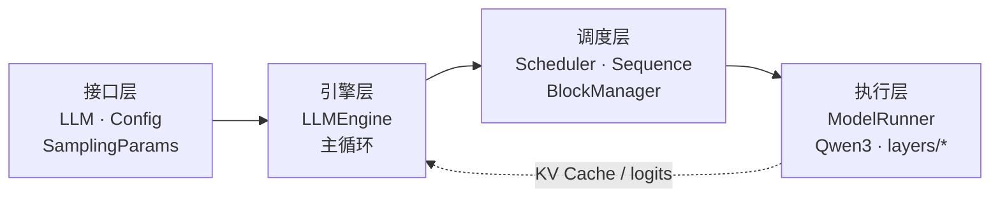
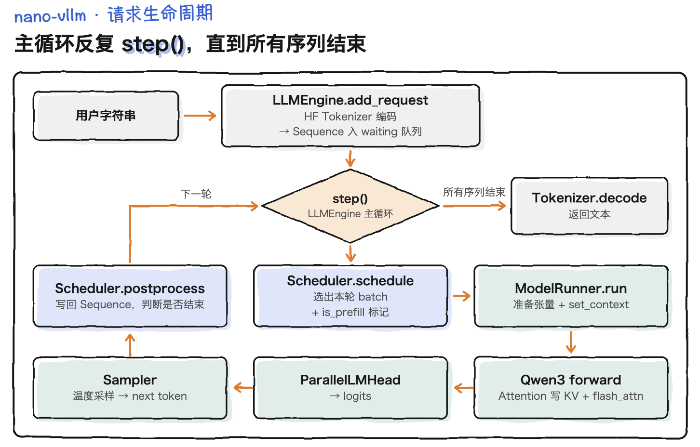

# nano-vllm（一）：接口与引擎主循环

[nano-vllm](https://github.com/GeeeekExplorer/nano-vllm) 用约一千行 Python 实现了一个可用的推理引擎，包含 PagedAttention 式的块管理、前缀缓存、张量并行和 CUDA Graph，在小模型上的吞吐接近 vLLM。它去掉了 vLLM 大量的工程分支，很适合拿来把前面几章的概念对应到代码。

这一部分分三页：

1. **接口与引擎主循环**（本页）：目录结构、`Config`、`LLMEngine` 和 `step()` 循环
2. [**模型与核心算子**](02-model.md)：Qwen3 的每个算子、张量并行、Attention 与采样
3. [**调度与 ModelRunner**](03-runner.md)：调度器、张量准备、KV Cache 分配与 CUDA Graph

## 目录与模块分工
```
nanovllm/
├── __init__.py          # 对外导出 LLM, SamplingParams
├── config.py            # Config 全局配置（dataclass）
├── llm.py               # LLM：直接继承 LLMEngine，类体只有 pass
├── sampling_params.py   # SamplingParams 采样超参
├── engine/
│   ├── llm_engine.py    # 引擎主循环：调度 → 前向 → 采样 → 更新
│   ├── scheduler.py     # Prefill/Decode 调度与抢占
│   ├── sequence.py      # 单条请求的状态机
│   ├── block_manager.py # KV Cache 的分块分配与回收
│   └── model_runner.py  # GPU 侧执行：张量准备、Context、CUDA Graph
├── layers/
│   ├── attention.py     # Triton 写 KV + FlashAttention 前向
│   ├── linear.py        # 列/行/QKV/合并 并行 Linear
│   ├── embed_head.py    # 词表并行 Embedding 与 LMHead
│   ├── layernorm.py     # RMSNorm
│   ├── activation.py    # SiluAndMul（SwiGLU）
│   ├── rotary_embedding.py  # RoPE 旋转位置编码
│   └── sampler.py       # 温度采样（指数噪声 + argmax）
├── models/
│   └── qwen3.py         # Qwen3 模型实现
└── utils/
    ├── context.py       # 全局推理上下文（is_prefill、cu_seqlens 等）
    └── loader.py        # safetensors 权重加载
```

`engine/` 决定这一步算谁、怎么调度；`layers/` 和 `models/` 做矩阵运算；`utils/` 负责跨模块传递上下文和加载权重。最外层的 `__init__.py` 只导出 `LLM` 和 `SamplingParams` 两个名字，用户只需要接触这两个入口。



**第一层：接口层（`llm.py` + `sampling_params.py` + `config.py`）**

用户只接触 `LLM`（提供 `generate`）和 `SamplingParams`（温度、最大生成长度等）。`Config` 在引擎初始化时把显存比例、最大批大小、张量并行度、KV 块大小等全局约束固定下来。这一层的对外 API 很小，不懂调度也能跑通推理。

**第二层：引擎层（`engine/llm_engine.py`）**

`LLMEngine` 持有调度器、模型执行器和分词器，跑一个循环：**从调度器拿一批序列 → 交给执行器做一次前向并采样出下一个 token → 把结果写回序列状态**，直到所有请求结束。

**第三层：调度层（`scheduler.py` + `sequence.py` + `block_manager.py`）**

这一层决定「这一步跑谁、它们的 KV 放哪儿」。`Scheduler` 决定本轮是 prefill 还是 decode、把哪些序列拼成一个 batch；`Sequence` 跟踪每条请求的 token、已缓存长度和状态；`BlockManager` 按 PagedAttention 的思路给 KV 分配物理块。这一层**只管资源分配与生命周期，不碰矩阵乘法**，所以 `BlockManager` 放在 `engine/` 而不是 `layers/`。

**第四层：执行层（`model_runner.py` + `models/qwen3.py` + `layers/*`）**

`ModelRunner` 把调度器选出的序列转成张量：构造 `input_ids`、`positions`、`slot_mapping`、`block_tables` 等，设置全局 `Context`，然后调用 `Qwen3` 前向。`layers/` 是算子级实现，其中 `attention.py` 有两项任务：把新的 K/V 写进 Cache，以及调用 FlashAttention 计算注意力。



1. 用户调用 `llm.generate(prompts, sampling_params)`。prompt 可以是字符串，也可以是已经编码好的 token id 列表；字符串由 `add_request` 内部的 HuggingFace 分词器编码。
2. `add_request` 为每条 prompt 创建一个 `Sequence`，放进 `Scheduler` 的 `waiting` 队列。
3. 主循环每执行一次 `step()`：`Scheduler` 根据 Token Budget 和 KV 余量选出本轮要跑的序列，并标记这是一次 **prefill**（处理 prompt）还是 **decode**（逐 token 生成）。
4. `ModelRunner` 把这批序列转成 GPU 张量，写好全局 `Context`，跑一遍 `Qwen3`。前向过程中 `Attention` 把新算出的 K/V 存进 KV Cache，再用 FlashAttention 算注意力。
5. 模型输出的 hidden state 过 `ParallelLMHead` 得到 logits，`Sampler` 按温度采样出下一个 token。
6. `Scheduler.postprocess` 把新 token 写回对应 `Sequence`，判断是否命中 EOS 或达到 `max_tokens`。结束的序列释放 KV 块，未结束的留到下一轮 decode。
7. 所有序列结束后，`generate` 按 `seq_id` 排序还原请求顺序，解码成字符串返回。

## `generate` 调用流程

对外 API 只有三样：`LLM`、`SamplingParams` 和 `generate`

```python
import os
from transformers import AutoTokenizer
from nanovllm import LLM, SamplingParams

path = os.path.expanduser("~/huggingface/Qwen3-0.6B/")   # 本地模型目录

# 1) 构造引擎：本地路径 + 全局开关
llm = LLM(path, enforce_eager=True, tensor_parallel_size=1)

# 2) 定义采样策略
sampling_params = SamplingParams(temperature=0.6, max_tokens=256)

# 3) Chat 模型先套对话模板，再交给引擎
tokenizer = AutoTokenizer.from_pretrained(path)
questions = ["用一句话介绍 PagedAttention", "100 以内有哪些质数"]
prompts = [
    tokenizer.apply_chat_template([{"role": "user", "content": q}],
                                  tokenize=False, add_generation_prompt=True)
    for q in questions
]

# 4) 批量生成：每个元素是 {"text": ..., "token_ids": ...}
outputs = llm.generate(prompts, sampling_params)
print(outputs[0]["text"])
```

## `Config` 与初始化

以下 `Config` 字段来自这份笔记所讨论的 nano-vllm 实现；上游版本更新后可能变化。

```python
@dataclass(slots=True)
class Config:
    model: str                              # 本地模型目录（必填）
    max_num_batched_tokens: int = 16384     # 单步最多处理的 token 总数（Token Budget）
    max_num_seqs: int = 512                 # 单步最多并发的序列数
    max_model_len: int = 4096               # 支持的最大上下文长度
    gpu_memory_utilization: float = 0.9     # 允许占用的显存比例
    tensor_parallel_size: int = 1           # 张量并行 GPU 数
    enforce_eager: bool = False             # True 则禁用 CUDA Graph
    hf_config: AutoConfig | None = None     # 在 __post_init__ 里加载的 HF 配置
    eos: int = -1                           # EOS token id（初始化后由 tokenizer 填入）
    kvcache_block_size: int = 256           # 每个 KV 块容纳的 token 数
    num_kvcache_blocks: int = -1            # KV 块总数（运行时按显存推算）
```

构造后 `__post_init__` 做三条断言，加载 HF 配置，并把上下文长度截到模型支持的上限：

```python
def __post_init__(self):
    assert os.path.isdir(self.model)                 # 必须是存在的本地目录
    assert self.kvcache_block_size % 256 == 0        # 块大小需 256 的整数倍
    assert 1 <= self.tensor_parallel_size <= 8       # TP 度在 1~8 之间
    self.hf_config = AutoConfig.from_pretrained(self.model)
    self.max_model_len = min(self.max_model_len,
                             self.hf_config.max_position_embeddings)
```

`@dataclass` 会生成 `__init__()`；`__post_init__()` 则在初始化后执行校验和派生字段的设置。

**`kvcache_block_size = 256`**：每个 KV 块装多少个 token。块越大，块表（Block Table）越短、管理开销越小，但最后一块没填满造成的内部碎片也越大。`% 256 == 0` 这条断言来自底层算子的要求：flash-attn 的 `flash_attn_with_kvcache` 文档写明，传入 `block_table`（分页 KV）时 `page_block_size` 必须是 256 的倍数。nano-vllm 的 decode 路径和前缀命中的 prefill 路径都通过 `block_table` 读分页 KV，所以块大小只能取 256、512 这类值，256 是允许的最小值，不是在碎片和开销之间挑出来的折中。

`256` 是这里讨论的 nano-vllm 版本的默认值；它与 vLLM 的块大小配置相互独立。

**`max_num_batched_tokens` 与 `max_num_seqs`**：前者是单步 Token Budget，后者是单步序列数上限。两者共同约束 Batch 大小。

**`gpu_memory_utilization = 0.9`**：引擎加载权重并估计执行所需显存后，用剩余显存预算分配 KV 块。`num_kvcache_blocks` 因此初始为 `-1`，运行时再确定。

**`tensor_parallel_size ≤ 8`**：这是该实现配置中的断言；实际可用的 TP 度还受模型约束，Qwen3 实现要求注意力头数和 KV 头数都能被 TP 度整除。

## `SamplingParams`

nano-vllm 的 `SamplingParams` 只有三个字段：

```python
@dataclass(slots=True)
class SamplingParams:
    temperature: float = 1.0
    max_tokens: int = 64
    ignore_eos: bool = False

    def __post_init__(self):
        assert self.temperature > 1e-10, "greedy sampling is not permitted"
```

- **`temperature`**：温度，控制采样随机性。
- **`max_tokens`**：最多生成多少个 token，默认 `64`（示例里显式设成了 `256`）。它既是停止条件，也用于 benchmark 时固定生成量。
- **`ignore_eos`**：是否忽略 EOS 继续生成。`bench.py` 把它设为 `True`，保证每条序列都生成满 `max_tokens`，吞吐数据才可比。

**关键点**：`__post_init__` 断言温度必须大于 `1e-10`，也就是说 **nano-vllm 不支持贪心采样**（temperature=0）。它的 `Sampler` 只有一条随机采样路径：logits 除以温度后做 softmax，再用指数噪声取 argmax。温度为 0 时除法会出错，作者没有为这种情况单独写 argmax 分支，而是在入口处挡掉。想要接近确定性的输出，可以把温度设成一个很小的正数。

## `LLM` 与 `LLMEngine`

`llm.py` 只有 5 行，`LLM` 直接继承 `LLMEngine`，类体是 `pass`，`generate` 等方法全部来自父类。所有初始化工作都在 `LLMEngine.__init__` 里，分四步：

```python
class LLMEngine:
    def __init__(self, model, **kwargs):
        # 1) 从 kwargs 里挑出 Config 认识的字段，构造全局配置
        config_fields = {f.name for f in fields(Config)}
        config = Config(model, **{k: v for k, v in kwargs.items()
                                   if k in config_fields})
        # 把块大小同步给 Sequence（它用类变量记 block_size）
        Sequence.block_size = config.kvcache_block_size

        # 2) 张量并行：用 spawn 启动 rank>0 的 worker 子进程
        ctx = mp.get_context("spawn")
        self.ps, self.events = [], []
        for rank in range(1, config.tensor_parallel_size):
            event = ctx.Event()
            p = ctx.Process(target=ModelRunner, args=(config, rank, event))
            p.start()
            self.ps.append(p); self.events.append(event)
        # rank 0 的 ModelRunner 跑在主进程
        self.model_runner = ModelRunner(config, 0, self.events)

        # 3) 分词器只在主进程持有，并把 EOS 回填到 config
        self.tokenizer = AutoTokenizer.from_pretrained(config.model, use_fast=True)
        config.eos = self.tokenizer.eos_token_id

        # 4) 调度器 + 退出清理
        self.scheduler = Scheduler(config)
        atexit.register(self.exit)
```

这里有几处工程细节：

- **为什么用 `spawn` 而不是 Linux 默认的 `fork`**：CUDA 运行时不支持在 `fork` 出的子进程里重新初始化。父进程一旦初始化过 CUDA，`fork` 出的子进程再用 GPU 就会报错。`spawn` 启动的是全新的解释器进程，每个 rank 各自初始化自己的 GPU。
- **主从进程靠共享内存 + `Event` 通信**：`rank>0` 的 `ModelRunner` 在子进程的 `__init__` 末尾进入循环，等待任务。主进程把方法名和参数 pickle 后写进共享内存，再 `set` 每个 worker 的 `Event` 通知它读取。细节见 [ModelRunner](03-runner.md)。
- **分词器只在主进程**：编码和解码都是 CPU 任务，TP worker 只需要 token id，不需要各自加载一份分词器。
- **`atexit` 清理**：退出时通过同一套 RPC 给子进程发 `"exit"`，再 `join` 回收，避免残留进程。

**提示**：`Sequence.block_size = config.kvcache_block_size` 这一行容易被忽略。`Sequence` 用**类变量**记录块大小，所有序列共享同一个值，`num_blocks`、`last_block_num_tokens` 等属性都靠它计算。

`fork` 复制父进程的状态，并通过写时复制共享尚未修改的内存页；`spawn` 启动新的 Python 解释器。若父进程已初始化 CUDA，再用 `fork` 创建需要使用 CUDA 的子进程，可能触发 PyTorch 的 *Poison Fork* 问题。nano-vllm 因此用 `spawn` 启动 TP worker。

| 方式 | 进程状态 | CUDA 使用要点 |
| --- | --- | --- |
| `fork` | 继承父进程当时的状态，启动通常较快 | 避免在已初始化 CUDA 的父进程中 fork 出 CUDA worker。 |
| `spawn` | 启动新解释器，重新导入模块 | worker 各自初始化 CUDA；入口通常需要 `if __name__ == "__main__":`。 |

## add_request → step → postprocess

`generate` 的骨架如下（去掉了 tqdm 进度条与吞吐统计）：

```python
def generate(self, prompts, sampling_params, use_tqdm=True):
    # 单个 SamplingParams 复制给每条 prompt；也可以传一个等长列表
    if not isinstance(sampling_params, list):
        sampling_params = [sampling_params] * len(prompts)
    for prompt, sp in zip(prompts, sampling_params):
        self.add_request(prompt, sp)

    outputs = {}
    while not self.is_finished():
        finished, num_tokens = self.step()   # 跑一步，拿回本步完成的序列
        for seq_id, token_ids in finished:
            outputs[seq_id] = token_ids

    # 序列完成的先后顺序和提交顺序不同，按 seq_id 排序还原
    outputs = [outputs[i] for i in sorted(outputs)]
    return [{"text": self.tokenizer.decode(ids), "token_ids": ids}
            for ids in outputs]
```

`seq_id` 由 `Sequence` 的类级计数器递增分配，所以按 `seq_id` 排序就等于按提交顺序排序。短 prompt 往往先结束，没有这一步排序，返回顺序会和输入对不上。

**`add_request`**：把一条 prompt 变成一个 `Sequence` 放进调度器。prompt 可以是字符串（内部先 `encode`）也可以是现成的 token id 列表

```python
def add_request(self, prompt, sampling_params):
    if isinstance(prompt, str):
        prompt = self.tokenizer.encode(prompt)
    self.scheduler.add(Sequence(prompt, sampling_params))
```

**`step`**：一次完整的「调度 → 前向 → 写回」：

```python
def step(self):
    seqs, is_prefill = self.scheduler.schedule()                  # 选 batch
    # 必须在 postprocess 之前统计：postprocess 会把 num_scheduled_tokens 清零
    num_tokens = sum(seq.num_scheduled_tokens for seq in seqs) if is_prefill else -len(seqs)
    token_ids = self.model_runner.call("run", seqs, is_prefill)  # 跑模型 + 采样
    self.scheduler.postprocess(seqs, token_ids, is_prefill)      # 写回、判断结束
    outputs = [(seq.seq_id, seq.completion_token_ids)
               for seq in seqs if seq.is_finished]
    return outputs, num_tokens
```

**关键点**：`num_tokens` 用**正负号**区分阶段。prefill 时返回正数，即这一步实际计算的 token 总量（开启 chunked prefill 后可能只是 prompt 的一部分）；decode 时返回负的 batch 大小 `-len(seqs)`。`generate` 根据符号分别计算 Prefill 和 Decode 吞吐（tok/s）显示在进度条上。这一行的位置不能挪到 `postprocess` 之后，否则 `num_scheduled_tokens` 已经被清零，prefill 吞吐会一直显示为 0。

循环里的分工是：**`model_runner.call("run", ...)` 负责怎么算，`scheduler` 负责算谁、算完怎么办**。`call` 在 TP=1 时就是普通的方法调用，TP>1 时还会把同一个调用广播给其他 rank。[下一页](02-model.md)展开模型执行层和关键算子。
