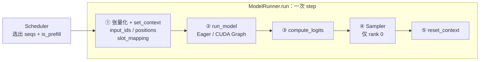

# nano-vllm（三）：调度与 ModelRunner

## Scheduler：等待、运行与抢占

nano-vllm 的 `Scheduler` 用两条队列管理请求：

| 队列 | 保存的请求 | 调度行为 |
| --- | --- | --- |
| `waiting` | 新请求、未完成 Prefill 的请求，以及被抢占后需要重新计算的请求 | 优先安排 Prefill；未算完的请求留在队首，下一步继续 |
| `running` | Prefill 已完成、正在 Decode 的请求 | 本步没有可调度的 Prefill 时，才安排 Decode |

`schedule()` 返回 `(seqs, is_prefill)`，所以 nano-vllm **同一步只执行一种阶段**，这和 vLLM V1 的混合调度不同（对比见 [Continuous Batching](../04-continuous-batching.md#两种调度器的对比)）。

- **Prefill 优先于 Decode**。如果 Token Budget 不够，允许本批第一条请求分块 Prefill，后续请求等下一步。
- **Decode 时 KV 块不足就抢占**：从 `running` 尾部踢出请求、释放它的块，并把它放回 `waiting` 队首。恢复时要重新 Prefill（命中前缀缓存的满块可以跳过）。
- **`may_append`**：Decode 前检查每条序列的新 Token 是否会跨入新块，需要的话提前分配。所以执行时新 Token 一定落在 `block_table[-1]` 里。
- **`postprocess()`**：更新已缓存 Token 数，追加采样结果，给写满的块计算哈希以供前缀缓存复用，在 EOS 或长度上限时释放块。

## 一次 step 的全貌

```text
Engine 初始化（只执行一次）
    ├── 加载模型权重
    ├── warmup，测激活显存峰值
    ├── 用剩余显存分配 KV Cache
    └── 捕获 Decode 的 CUDA Graph
    │
    ▼
while not is_finished():                 ← generate() 的外层循环
    Engine.step()
        ├── Scheduler.schedule()          → 选出 seqs, is_prefill
        ├── ModelRunner.run(seqs, is_prefill)
        │       ├── prepare_prefill / prepare_decode   张量化 + set_context
        │       ├── run_model                          eager 或 CUDA Graph 重放
        │       ├── compute_logits
        │       ├── sampler                            仅 rank 0
        │       └── reset_context
        └── Scheduler.postprocess()       → 写回 Token、哈希满块、释放结束的序列
```

## ModelRunner：从请求到 GPU 前向

`LLMEngine.step()` 每轮调用一次 `ModelRunner.run(seqs, is_prefill)`。它把 `Sequence` 对象转成 GPU 张量，执行模型前向和采样；只有 rank 0 返回采样出的 Token ID：

```python
def run(self, seqs, is_prefill):
    if is_prefill:
        input_ids, positions = self.prepare_prefill(seqs)
    else:
        input_ids, positions = self.prepare_decode(seqs)
    temperatures = self.prepare_sample(seqs) if self.rank == 0 else None
    logits = self.run_model(input_ids, positions, is_prefill)   # eager 或 CUDA Graph 重放
    token_ids = self.sampler(logits, temperatures).tolist() if self.rank == 0 else None
    reset_context()
    return token_ids
```



`ModelRunner.__init__` 在引擎启动时按固定顺序做准备：

1. 用 NCCL 初始化进程组，绑定本 rank 的 GPU，把默认 dtype 设为模型的 dtype（Qwen3-0.6B 是 BF16）。
2. 构造 `Qwen3ForCausalLM` 并从 safetensors 加载权重。
3. `warmup_model`：跑一次最大规模的 Prefill，测出激活显存的峰值。
4. `allocate_kv_cache`：把剩余显存切成 KV 块。
5. `enforce_eager=False` 时执行 `capture_cudagraph`，预先捕获 Decode 的 CUDA Graph。
6. TP > 1 时建立共享内存，rank > 0 进入 `loop` 等待 rank 0 的指令。

## Prefill 与 Decode 的张量准备

模型 `forward` 吃的是张量，调度器给的是一批 `Sequence` 对象，两个阶段需要的张量形态不同。

### Prefill：变长序列拼在一起

`prepare_prefill()` 把多条不同长度的请求首尾相接成一个一维的 Token 序列（没有 padding），生成：

- **`input_ids`、`positions`**：本步要计算的 Token 及其位置。
- **`cu_seqlens_q` / `cu_seqlens_k`**（cumulative sequence lengths）：用累积长度标出每条序列的边界，这是 `flash_attn_varlen_func` 要求的格式。Q 侧只含本步要算的 Token，K 侧从序列开头算起，包含已缓存的历史。
- **`block_tables`**：只有当某条序列的 K 比 Q 长（命中前缀缓存，或是 Chunked Prefill 的后续块）时才准备，让 Attention 从分页 KV Cache 读取历史部分。
- **`slot_mapping`**：每个新 Token 的 K/V 要写到 KV Cache 的哪个物理槽位。

例如两条请求分别新增 2、3 个 Token，第一条已有 4 个缓存的历史 Token，第二条没有历史：

```text
cu_seqlens_q = [0, 2, 5]
cu_seqlens_k = [0, 6, 9]
```

对序列中的位置 `pos`，物理槽位为：

```python
block_index = pos // block_size
slot = block_table[block_index] * block_size + pos % block_size
```

### Decode：每条序列一个 Token

`prepare_decode()` 为每条序列准备一个输入 Token，以及 `positions`、`context_lens`、`slot_mapping` 和 `block_tables`：

- **读 `last_token` 而不是 `token_ids[-1]`**：TP > 1 时，主进程发给 worker 的 Decode 序列只带 `last_token`，不传完整 Token 历史，减少序列化开销。
- **`context_lens` 包含当前 Token**：Attention 先执行 `store_kvcache` 把新 Token 的 K/V 写进缓存，再读取截至当前位置的全部 KV，所以长度要把它算进去。
- **slot 一定在最后一块**：调度器的 `may_append` 已经为跨块的 Token 分好了新块。

!!! note "两种 -1 不是一回事"
    - `block_tables` 右侧补的 `-1` 只是为了对齐成矩阵，Kernel 按 `context_lens` 只读前面的有效块，不会访问补位。
    - `slot_mapping = -1` 来自 CUDA Graph 回放时补齐的虚拟 Token，表示这些位置**不能写入** KV Cache，由 [`store_kvcache`](02-model.md#attention) 跳过。

## 全局 Context：算子的「隐式参数」

`cu_seqlens`、`slot_mapping`、`block_tables`、`is_prefill` 这些张量，Attention、LMHead 等算子都要用。如果当函数参数一层层往下传，`Qwen3ForCausalLM`、每个 `DecoderLayer`、每个 `Attention` 的 `forward` 都要多出七八个参数。

nano-vllm 把它们放进一个全局 Context（`utils/context.py`）：前向前用 `set_context()` 写入，算子内部用 `get_context()` 现取，本步结束再 `reset_context()`。这样模型代码可以保持和 HuggingFace 实现几乎一样的签名。vLLM 中对应的是 `ForwardContext` / Attention Metadata。

## KV Cache 分配

`slot_mapping` 指向的物理显存，是引擎启动时一次性分配好的。`ModelRunner` 不按最大长度给每条请求预留，而是**先加载权重、用 warmup 测出激活峰值，再把剩下的显存全部切成 KV 块**。这就是 `Config.num_kvcache_blocks` 初始为 `-1`、运行时才算出来的原因。

warmup 用一批假序列跑一次最大规模的 Prefill：

```python
def warmup_model(self):
    torch.cuda.empty_cache()
    torch.cuda.reset_peak_memory_stats()              # 峰值统计从这里重新开始
    seq_len = min(max_num_batched_tokens, max_model_len)
    num_seqs = min(max_num_batched_tokens // seq_len, max_num_seqs)
    seqs = [Sequence([0] * seq_len) for _ in range(num_seqs)]   # 没有 block_table 的假序列
    for seq in seqs:
        seq.num_scheduled_tokens = seq_len
    self.run(seqs, True)
    torch.cuda.empty_cache()
```

随后 `allocate_kv_cache()` 根据总显存 × `gpu_memory_utilization`、当前占用和峰值增量算出可用字节数，再除以单块字节数得到块数。单块字节数为：

$$
2 \times L \times \text{block\_size} \times H_{kv}^{\text{per-rank}} \times D \times P
$$

和[第 1 章的 KV Cache 公式](../01-basics.md#prefilldecode-与-kv-cache)是同一回事，只是把序列长度换成了块大小。

## CUDA Graph 路径

nano-vllm 只对 Decode 捕获 CUDA Graph。`run_model()` 在 Prefill、`enforce_eager=True` 或 Batch 大于 512 时走 eager；否则选一个不小于当前 Batch 的已捕获尺寸，把输入填进静态缓冲区后重放图。图只覆盖到模型前向输出 hidden states，`compute_logits()` 和采样都在图外执行。

捕获尺寸为 `[1, 2, 4, 8]` 加上不超过 `min(max_num_seqs, 512)` 的所有 16 的倍数。实际 Batch 为 13 时按 16 的图重放，多出来的 3 个位置 `slot_mapping` 设为 `-1`，避免写入无效 KV。

这里描述的是 nano-vllm 的实现，vLLM 的图模式更复杂（Piecewise、Full 等），见[第 7 章](../07-graph-optimization.md)。
