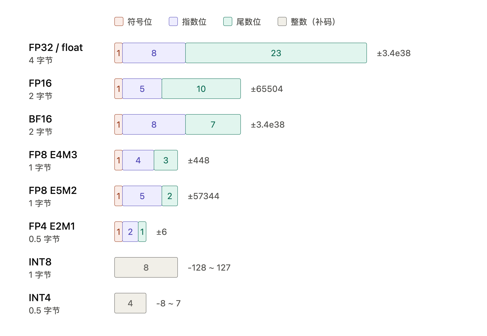

# 数值格式与量化基础

## 数值格式

### 有符号整数（补码）

$n$ 位补码的最高位权重是 $-2^{n-1}$，其余位权重为正，按位加起来就是数值。以 INT8 为例：

- `1111 1111` $= -128 + 127 = -1$
- `1000 0000` $= -128 + 0 = -128$
- 表示范围是 $[-128, 127]$

整数是**等间距**的格子。

### 浮点数



浮点数由符号位、指数位和尾数位组成：**指数位决定范围，尾数位决定精度**。

| 格式 | 位数 | 符号 / 指数 / 尾数 | 最大值（约） | 特点 |
| --- | ---: | --- | ---: | --- |
| FP32 | 32 | 1 / 8 / 23 | $3.4\times10^{38}$ | 训练中的主权重、累加器 |
| FP16 | 16 | 1 / 5 / 10 | 65504 | 精度较高、范围小，容易溢出 |
| BF16 | 16 | 1 / 8 / 7 | $3.4\times10^{38}$ | 范围与 FP32 相同，精度较粗 |
| FP8 E4M3 | 8 | 1 / 4 / 3 | 448 | 常用于前向的权重和激活 |
| FP8 E5M2 | 8 | 1 / 5 / 2 | 57344 | 范围更大，常用于梯度 |
| FP4 E2M1 | 4 | 1 / 2 / 1 | 6 | 只能表示 0, 0.5, 1, 1.5, 2, 3, 4, 6 及其负数 |

FP16 和 BF16 都是 2 Bytes。BF16 和 FP32 一样有 8 位指数，表示范围相同，只是精度粗一些，几乎不会溢出，所以现在训练和推理的默认格式是 BF16。FP16 精度更高但范围小，大模型训练中容易溢出，需要配合 loss scaling。

FP32 仍有它的位置：混合精度训练中，大部分矩阵乘用 BF16/FP16，但主权重、梯度累加和优化器状态通常保留 FP32，以保证数值稳定。

**浮点和整数的根本区别在于间距。** 浮点数的指数让数值在 0 附近很密、远离 0 时很稀；整数是等间距的格子。所以 INT 量化必须用一个 scale（有时再加一个 zero-point）把实数区间映射到这些格子上。FP8/FP4 的表示范围很小，同样需要配 scale。

## 量化为什么能加速

这是 MLSys 视角下最关键的一点，要和 [Roofline](../performance/roofline.md) 联系起来看：

- **Decode 是 Memory-bound**：每生成一个 Token 都要把全部权重从 HBM 读一遍。权重压到 INT4，搬运量就降到 FP16 的约 1/4，这是 **W4A16**（权重 4 bit、激活 16 bit）的收益来源。计算时权重在寄存器里反量化回 FP16，矩阵乘本身还是 FP16。
- **Prefill 和大 Batch 是 Compute-bound**：只压缩权重没用，必须让矩阵乘本身跑在 INT8 / FP8 / FP4 Tensor Core 上，这就需要 **W8A8** 这类权重和激活都量化的方案。

## 量化的基本原理

### 映射公式

非对称（affine）量化：

$$
s=\frac{x_{\max}-x_{\min}}{q_{\max}-q_{\min}},\qquad z=q_{\min}-\operatorname{round}(x_{\min}/s)
$$

$$
q=\operatorname{clamp}(\operatorname{round}(x/s)+z,\ q_{\min},q_{\max}),\qquad \hat x = s(q-z)
$$

对称量化令 $z=0$，$s=\max|x|/q_{\max}$（INT8 时 $q_{\max}=127$，INT4 时为 7）。

误差有两个来源，需要权衡：

- **舍入误差**：scale 越大，格子越粗，舍入误差越大。
- **截断（clipping）误差**：scale 取得太小，大值会被截断到 $q_{\max}$。

### 粒度

从粗到细依次是 per-tensor、per-channel、per-group（例如沿输入维每 128 个元素一组）、per-token。

细粒度的意义在于对付 outlier：一个超大值会把整组的 scale 撑大，组内其他值都只能落在少数几个格子上。粒度越细，一个 outlier 波及的范围越小，代价是要存更多 scale。

### 量化谁

常见写法是 W$x$A$y$，例如 W4A16、W8A8、W4A8，另外还有 KV Cache 量化。下面这个推导值得亲手写一遍：

$$
Y=XW^\top \approx \operatorname{diag}(s_x)\,(X_q W_q^\top)\,\operatorname{diag}(s_w)
$$

其中 $s_x$ 是 per-token 的 scale，$s_w$ 是 per-output-channel 的 scale。中间的 $X_q W_q^\top$ 是纯粹的 INT8×INT8→INT32 GEMM，两侧的 scale 可以放进 GEMM 的 epilogue 里处理。

**如果 scale 落在规约维 $K$ 上**（也就是激活做 per-input-channel 量化），它就没法从矩阵乘里提出来，也就无法用整数 GEMM 加速。而激活的 outlier 恰恰集中在少数几个 input channel 上——这正是激活难量化的系统层面原因，也是 [SmoothQuant](#smoothquant) 要解决的问题。

```python
import torch

def quant_sym(x, bits=8, dim=None):
    qmax = 2 ** (bits - 1) - 1
    amax = x.abs().amax(dim=dim, keepdim=True) if dim is not None else x.abs().max()
    s = amax.clamp(min=1e-8) / qmax
    q = torch.clamp(torch.round(x / s), -qmax - 1, qmax)
    return q, s                      # 反量化: q * s

def fake_quant_group(W, bits=4, group=128):   # W: [out, in]
    O, I = W.shape
    q, s = quant_sym(W.reshape(O, I // group, group), bits, dim=-1)
    return (q * s).reshape(O, I)
```

## AWQ：按激活挑出重要的权重

参考：[AWQ 论文](https://arxiv.org/abs/2306.00978)、[知乎解读](https://zhuanlan.zhihu.com/p/942485319)

先澄清三个常见疑问：

1. **AWQ 量化的是什么？** 只量化 Weight（通常 INT4，group size 128），Activation 保持 BF16/FP16，属于 W4A16。
2. **Activation 大的 channel 是不是就不量化了？** 不是。所有 Weight 都会被量化成 INT4，只是激活大的 channel 对应的权重会在量化前先被放大。
3. **粒度是什么？** 缩放因子按 input channel 选取；量化本身是 group-wise 的。

### 直觉：激活大，误差被放大

对 $Y = XW$，某个输出的误差来自 $x\cdot(w-\hat w)$。同样的权重量化误差，乘上一个大激活，就会变成大的输出误差。所以**重要的权重不是数值大的权重，而是对应激活大的权重**。

### 一个数值例子

设 $\Delta=0.1$，激活 $x=100$，权重 $w=0.34$，真实输出 $xw=34$。

- **直接量化**：$\operatorname{round}(0.34/0.1)=3$，$\hat w=0.3$，输出 $100\times0.3=30$，误差 **4**。
- **AWQ 先缩放**，取 $s=2$：$w'=sw=0.68$，$x'=x/s=50$（数学上 $x'w'=xw$）。量化 $\operatorname{round}(0.68/0.1)=7$，$\hat w'=0.7$，输出 $50\times0.7=35$，误差 **1**。

原因是：权重放大 $s$ 倍后，舍入误差的绝对值不变（最多 $\Delta/2$），但对应的激活缩小了 $s$ 倍，乘回去的输出误差就缩小了。

前提是放大少数重要 channel 不会明显改变 group 的最大值，也就是 $\Delta$ 基本不变；放大过头会撑大 $\Delta$，反而伤害同组其他权重。所以 AWQ 用 $s = s_X^{\alpha}$（$s_X$ 是该 channel 激活的平均幅度），在校准集上网格搜索 $\alpha\in[0,1]$ 使输出误差最小。$1/s$ 会被融合进上一层（如 LayerNorm 或前一个 Linear）的权重里，推理时没有额外开销。

**AWQ 不是让 INT4 表示更大的数，而是通过等价变换，把量化误差更多地分配给不重要的 channel，让重要 channel 的输出误差变小。**

### 两种「Group」别搞混

| 对比 | AWQ 的 Group | GQA 的 Group |
| --- | --- | --- |
| 属于 | 模型量化 | Attention 结构 |
| 分组对象 | Weight 元素 | Query Heads |
| 目的 | 共享量化 scale，平衡误差与元数据开销 | 多个 Q Head 共享 K/V Head，减少 KV Cache 与带宽 |
| 常见配置 | Group Size = 128 | 例如 4 个 Q Head 共享 1 个 KV Head |

## SmoothQuant：把激活的难度迁移给权重 { #smoothquant }

参考：[SmoothQuant 论文](https://arxiv.org/abs/2211.10438)

W8A8 要求激活也量化成 INT8，但 LLM 的激活在少数 channel 上有极大的 outlier，而权重分布相对平坦。前面说过，per-input-channel 的激活 scale 无法从 GEMM 里提出来，所以只能用 per-token 或 per-tensor 量化，outlier 会把 scale 撑得很大。

SmoothQuant 的做法是对每个 input channel $j$ 做等价变换：

$$
Y = (X\operatorname{diag}(s)^{-1})\,(\operatorname{diag}(s)W),\qquad s_j=\frac{\max|X_j|^{\alpha}}{\max|W_j|^{1-\alpha}}
$$

激活的 outlier channel 被除以 $s_j$ 压平，对应的权重被乘以 $s_j$ 放大，量化难度从激活「迁移」一部分到权重。$\alpha$ 通常取 0.5 左右。和 AWQ 一样，$\operatorname{diag}(s)^{-1}$ 可以离线融合进上一层，推理时零开销；变换后激活和权重都适合用 INT8 量化，矩阵乘就能跑在 INT8 Tensor Core 上。

| | AWQ | SmoothQuant |
| --- | --- | --- |
| 方案 | W4A16 | W8A8 |
| 加速场景 | Memory-bound 的 Decode / 小 Batch | Compute-bound 的 Prefill / 大 Batch |
| 缩放目的 | 保护重要权重的精度 | 压平激活 outlier |
| 共同点 | 按 input channel 做等价缩放，并离线融合进相邻层 | |

## 延伸阅读

- [Give Me BF16 or Give Me Death? 量化精度与性能权衡](https://arxiv.org/abs/2411.02355)：系统比较 FP8、INT8、INT4 等方案在不同部署场景下的精度和速度。[知乎解读](https://zhuanlan.zhihu.com/p/5485556270)
