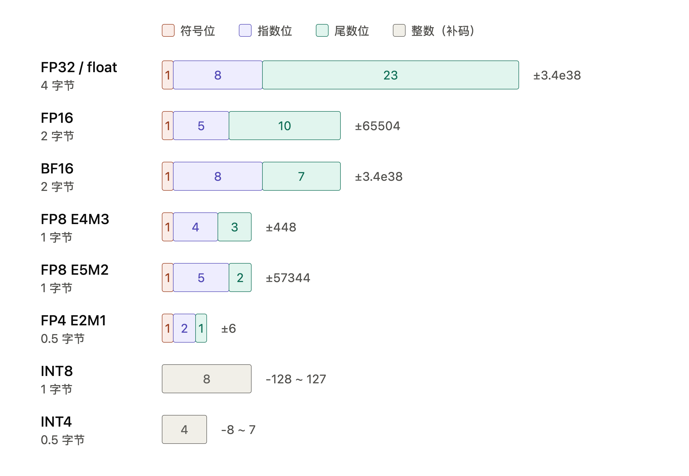

关于有符号数，这个就是首位 1，就是负，后面都是正，相加就行

比如int 8， 1111,1111就是 1*(-128)+127=-1

1000,000 就是 1*(-128)+0 =-128 



指数位决定范围，尾数位决定精度

fp16 and bf16 都是 2bytes 16bits

fp16 1 5 10 尾数多精度高，范围小，容易溢出

bf16 和 FP32 一样有 8 位指数，范围相同，只是精度粗一些。所以现在训练和推理的默认格式是 BF16。

**浮点和整数的根本区别在间距。** 浮点数的指数让数值靠近 0 时很密、远离 0 时很稀。整数是等间距的格子，所以 INT 量化必须靠一个 scale（有时再加一个 zero-point），把实数区间映射到这些格子上。FP8/FP4 本身表示范围很小（FP4 只能表示 0, 0.5, 1, 1.5, 2, 3, 4, 6 及其负数），同样需要配 scale

**量化为什么能加速，对 MLsys 来说是最关键的一点。**

- Decode 阶段是 memory-bound：每生成一个 token，都要把全部权重从 HBM 读一遍。权重缩到 1/4，搬运量就缩到 1/4，这是 W4A16 的收益来源。
- Prefill 和大 batch 是 compute-bound：只压缩权重没用，必须让矩阵乘本身跑在 INT8/FP8/FP4 Tensor Core 上，这就需要 W8A8 这类方案。


https://zhuanlan.zhihu.com/p/5485556270

## Give me BF16 or Give Me Death

1. 现代 [LLM](https://zhida.zhihu.com/search?content_id=250119502&content_type=Article&match_order=1&q=LLM&zhida_source=entity) 的存储和推理大多以 FP16 进行，其相比标准的 [FP32](https://zhida.zhihu.com/search?content_id=250119502&content_type=Article&match_order=1&q=FP32&zhida_source=entity)（32 位浮点数）在存储和计算上节省了几乎一半的资源。虽然 FP16 的精度可能降低，但是在大多数任务中，其表现往往与 FP32 相当。尤其是加上一些有效的[混合精度训练](https://zhida.zhihu.com/search?content_id=250119502&content_type=Article&match_order=1&q=混合精度训练&zhida_source=entity)，精度损失可控。
2. 在主流模型全面 FP16 的情况下，采用 FP32 的模型听着不那么可靠。（譬如先前某家称为 reflection 的模型，竟然是 FP32 的）不过，FP32 当然还有场景。在一些模型的训练初期，训练团队会采用 FP32 以确保数值稳定，特别是对于新的架构，需要较高精度防止溢出或者梯度消失。在混合精度训练中，大多的计算都是 FP16，但是关键的梯度累计和权重更新可能以 FP32 进行。
3. FP16 和 BF16 都是 16 位浮点数，但是 FP16 的数值范围小，精度高；BF16 的数值范围和 FP32 相当，但是精度比起 FP16 低。FP16 适合高精度低数值范围的计算，譬如图像处理，而 FP16 适合大动态范围的计算，减少数值溢出和下溢风险。

https://zhuanlan.zhihu.com/p/942485319

## AWQ：模型量化应当关注激活值

1. Activation 和 Weight 到底是什么关系？
2. Activation 大，是不是就不量化对应的 Weight 了？
3. AWQ 的粒度是什么？Layer、Channel，还是单个 Weight？

AWQ 仍然会把所有 Weight 量化成 INT4。Activation 大的 Channel 并不是不量化，而是在量化前对对应的 Weight 进行 Scaling，从而减小量化误差

假设：

\[ Y=XW \]

其中：

- \(X\)：Activation，来自上一层的输出。
- \(W\)：Weight，是模型训练好的参数。
- \(Y\)：这一层的输出，也会成为后续计算的 Activation。

也就是输入（A）越大，影响越大

AWQ 不会把 **Activation = 100 量化成 INT4！它量化的是 Weight**，而 Activation 仍然保持 BF16/FP16。

量化公式是：

\[ q=\mathrm{clip}\left(\mathrm{round}\left(\frac{w}{\Delta}\right),-8,7\right) \]

反量化：

\[ \hat w=q\Delta \]

比如一个activation 100，weight 0.3，w4a16的话就是，0.3/0.1=3， delta=0.1，

这里的 Activation 100，从头到尾都没有被量化成 INT4。

##### 那 AWQ 为什么要把 Weight 放大？

如果0.34的话，scale delta 0.1 损失0.04，a=100，损失4, 100*0.3=30

##### AWQ 如何改善这个问题

s=2，w’=sw=0.68，a‘=a/s=50, round(0.68/0.1)=7, 7*0.1\*a'=35, 损失1

**它不是让 INT4 表示更大的数，而是通过等价变换，把量化误差更多地分配给不重要的 Channel，让重要 Channel 的输出误差变小。**

通常的 AWQ W4A16 实现会采用 group-wise INT4 量化，例如 group size 128，但不同实现可以使用不同的设置。

| 对比         | AWQ 的 Group                                      | GQA 的 Group                                          |
| ------------ | ------------------------------------------------- | ----------------------------------------------------- |
| 属于什么     | 模型量化                                          | Attention 机制                                        |
| 分组对象     | Weight（权重）                                    | Query Heads                                           |
| 目的         | 共享 Quantization Scale，减少量化误差和元数据开销 | 让多个 Q Head 共享 K/V Head，减少 KV Cache 和带宽开销 |
| 常见配置     | Group Size = 128                                  | 例如 4 个 Q Heads 共享 1 个 KV Head                   |
| 推理时变化吗 | 不变                                              | Head 的共享关系不变                                   |

这里的group 概念不同


#### Level 1：基本映射公式

非对称（affine）量化：

$$s=\frac{x_{max}-x_{min}}{q_{max}-q_{min}},\quad z=q_{min}-\text{round}(x_{min}/s)$$$$q=\text{clamp}(\text{round}(x/s)+z,\ q_{min},q_{max}),\quad \hat x = s(q-z)$$

对称量化令 $z=0$，$s=\max|x|/q_{max}$（INT8 时 $q_{max}=127$，INT4 时为 7）。

误差有两个来源，二者需要权衡：

- 舍入误差：scale 越大，舍入误差越大。
- 截断（clipping）误差：scale 取得太小，大值会被截断。

#### Level 2：粒度（granularity）

粒度从粗到细依次是 per-tensor、per-channel、per-group（例如沿输入维每 **128** 个一组）、per-token。

细粒度的意义在于对付 outlier：一个超大值会把整组的 scale 撑大，导致组内其他值都只能落在少数几个格子上。粒度越细，一个 outlier 波及的范围越小。

#### Level 3：量化谁

常见写法是 W*x*A*y*，例如 W4A16、W8A8、W4A8，另外还有 KV cache 量化。下面这个推导值得亲手写一遍：

$$Y=XW^\top \approx \text{diag}(s_x)\,(X_q W_q^\top)\,\text{diag}(s_w)$$

其中 $s_x$ 是 per-token 的 scale，$s_w$ 是 per-output-channel 的 scale。中间的 $X_q W_q^\top$ 是纯粹的 INT8×INT8→INT32 GEMM，两侧的 scale 可以放进 epilogue 处理。

如果 scale 落在规约维 K 上（也就是激活做 per-input-channel 量化），它就没法从矩阵乘里提出来，也就无法用整数 GEMM 加速。这正是激活难量化的系统层面原因，也是后面 SmoothQuant 要解决的问题。

```python
import torch

def quant_sym(x, bits=8, dim=None):
    qmax = 2 ** (bits - 1) - 1
    amax = x.abs().amax(dim=dim, keepdim=True) if dim is not None else x.abs().max()
    s = amax.clamp(min=1e-8) / qmax
    q = torch.clamp(torch.round(x / s), -qmax - 1, qmax)
    return q, s                      # 反量化: q * s

def fake_quant_group(W, bits=4, group=128):   # W: [out, in]
    O, I = W.shape
    q, s = quant_sym(W.reshape(O, I // group, group), bits, dim=-1)
    return (q * s).reshape(O, I)
```

